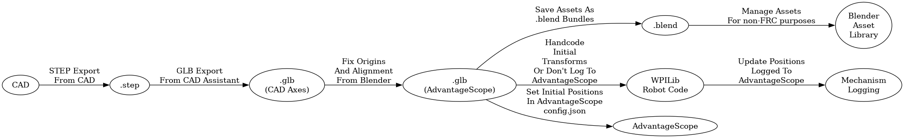

:PROPERTIES:
:ID:       6775e004-0ada-4858-a778-0a72aea6ed2d
:END:
#+TITLE: Blender: Learning A Bit of Basics
#+CATEGORY: slips
#+TAGS:

* Roam
+ [[id:b3826464-5132-4a77-9707-93a72bd1d4a3][Blender]]

* Resources

+ CGBoost: Sculpting Course
+ [[https://sandbox.babylonjs.com/][sandbox.babylon.js]] web preview for assets
  
Other apps

+ Substance Painter
+ Houdini (Visual FX with Nodes)

** Jupyter

*** databpy

+ [[https://github.com/kolibril13/bpy-gallery][kolibril13/bpy-gallery]] and [[https://kolibril13.github.io/bpy-gallery/][demo site]]
+ [[https://indico.cern.ch/event/1499330/attachments/2994404/5281610/Data%20visualisation%20using%20Blender%20within%20Jupyter%20notebooks-%20Cern%202025-compressed.pdf][Data visualisation using Blender within Jupyter notebooks]]

Presentation mentions extensions:

| addons  | [[https://bradyajohnston.github.io/MolecularNodes/examples/][bradyajohnston/MolecularNodes]]   | protein/biotech nodes                                        |
|         | bioxel                          | biomedical nodes                                             |
|         | [[https://extensions.blender.org/add-ons/csv-importer/][csv-importer]]                    |                                                              |
| assets  | [[https://www.cgfigures.ca/assetlibrary][CGFigures]]                       | scientific visualization assets                              |
| jupyter | [[https://github.com/manzt/quak][manzt/quak]]                      | interactive tables ~js -> jupyter -> bpy~                      |
|         | [[https://github.com/Octoframes/bpy_jupyter][octoframes/bpy_jupyter]]          | blender starts jupyter: expose jupyter kernel within blender |
|         | [[https://github.com/Octoframes/blender_notebook][Octoframes/blender_notebook]]     | jupyter starts blender                                       |
|         | [[https://github.com/bradyajohnston/databpy][bradyajohnston/databpy]]          | =uv pip install databpy bpy=                                   |
|         | [[https://huggingface.co/spaces/sci-blender/blender_drag_n_drop][sci-blender/blender_drag_n_drop]] | host notebooks online (huggingface, marimo)                  |

+ =uv pip install databpy= if installed within blender. (TODO: determine whether
  adding =bpy= is intended to support headless mode)

* Ideas

** FRC Photonvision

+ simple explanation for lens/sensor physics
  - configure rendering to simulate blur to help visualize the parameter's
    effects on what the photonvision or the java program will see
+ maybe a simulation (import FRC field & scale)

* Learning

Notes from SLC Blender meetup

+ Parsing =*.obj=: use a simple stateful object parser (keep track of state to
  build vertex lists, face maps, etc).

** Asset Management

| Exporters | bpy.data.collections["dude_1"].active_exporter_index |

+ upsaving
  - can add values under exporters for collections
  - adding multiple values per collection for the same format allows exporting
    =foobar.obj= and =foobar_002.obj=

** Scripting

+ data paths can be displayed as tooltips from the UI/UX (configure in preferences)
+ Right-click most UI elements, select "Copy full data path" or "Copy data path"
  - can now access conveniently from scripts

| viewport gizmos   | enable/disable | bpy.data.screens["Layout"].areas[3].spaces[0].show_gizmo            |
| viewport overlays | enable/disable | bpy.data.screens["Layout"].areas[3].spaces[0].overlay.show_overlays |

** Mesh Manipulation

Keyboard

|----------+-----------------+--------------------------+-----|
| context  | keys            |                          | api |
|----------+-----------------+--------------------------+-----|
| mesh/... | gx/gy/gz        | translate along axis     |     |
|          | a               | toggle selection         |     |
|          | S-a             | mesh menu                |     |
|          | S-a             |                          |     |
|          | z               | wireframe/solid/rendered |     |
|          | S-z             | toggle shading           |     |
|          | l               | select linked            |     |
|----------+-----------------+--------------------------+-----|
| views    | KP home/end     |                          |     |
|          | KP page up/down |                          |     |
|          | KP arrows       | rotate                   |     |
|          | =~=               | toggle walk/fly          |     |
|----------+-----------------+--------------------------+-----|

Misc Tools

| UI   |       | display normals           |
| UI   |       | display face orientations |
| Mesh | Array | create instances          |

*** Remesh

+ Voxelize volume along polygons then remesh evenly
+ Helps tons with export to STL or other formats where manifold required intact

Chain

| remesh | decimate | simple deform |

*** Cloth effect (physics)

+ instantiate a quad =Q= & add a physics collision mod
+ assign cloth effect onto modifer chain of object =P=
+ =P= now calculates physics: modifier is parameterized by time, =space= to
  activate. calculate effect to where you intend to save/export mesh.
  - otherwise requires a "driver" or other parameter automation

** Camera Control

+ [[https://www.youtube.com/watch?v=74mnpvN4ysk][How ILM Films Star Wars Motion Control Spaceships]] camera control with robotics
+ [[https://en.wikipedia.org/wiki/Three-point_lighting][3-point lighting]]

Exposure methods (see [[https://en.wikipedia.org/wiki/F-number][f-number, f-stops]])

+ x_min < fstop < x_max :: light at =fstop/2= doubles, DoF shallower (more blur)
+ time-based exposure

*** Driver

+ Effect can be assigned to cameras' params or other objects.
  - registered as =Cam > Animations > Driver > objname=
+ For camera, right click =Focus Distance > Automation=
  - Allows reproducible automation that keeps object in focus

** Geometry Nodes

+ Blender 5.2 will support traversing "lists in lists"
  - this makes it possible to import =*.obj= as text into geometry nodes
*** Physics

+ "Can physics be done in geometry nodes?" it's possible in lots of different
  ways, but may not be the best workflow

file-based workflow where =openvdb= integration could allow

#+begin_example dot
digraph G {
  geomNode -> openvdbFile -> openvdbSim -> geomNode
}
#+end_example

* Learning 2

** Godot Workflow

+ Make a new project from template
  + Ensure web-bundling is set (hard to enable later?)
+ Create the folder structure below. Then create a blending
+ create "suzanne on a cube", assign materials to BSDF (surface) to each asset,
  by pasting a color from clipboard. Ensure the exported object collections are
  nested inside a collection
+ Set exporter to export the collection:
  - to =godotproj/assets/{monkey,hat}.glb= at =./../hat.
  - save =godotproj/assets/monkey.blend=

*** Useful tools

+ Modifiers: edge split (to smooth hat)
  - ensure apply modifiers is checked
  - =edge split= smooths the hat. does this travel with the glb? or does it edit
    the mesh?
    
*** Assets    

#+begin_verse
.
└── godotproj
    ├── assets.blend.import
    └── assets
        ├── assets.blend
        ├── monkey.blend.import (godot metadata)
        ├── monkey.blend
        ├── hat.blend
        ├── hat.blend.import (godot metadata)
        └── source
#+end_verse

These are accessible from godot editor via =res://=

#+begin_quote
res:// is a custom URI protocol that points to the root directory of your
project game files. It stands for "resources" and represents the folder
containing your project.godot file.
#+end_quote

*** Asset Libraries

**** Collection Exports

New feature (4.3) helps develop assets with modeling workflow

+ Place into schene graph as collection of collections
+ Use =Properties= Area to set =Exporters= on the collection to save export settings
  inside the blend file.

Then use =Export All Collections= to automate the flow. Godot will pick up new
assets. (i think the next build will bundle them into the program, but the
actual editor recognizes they're created.)

*** Texture mapping

+ u :: unwrapping
  + Project from view
+ ensure that "shared selection" ... (idk but it seemed important lol)

*** Shader Chain

=bookcase.png[color] -> BSDF[color?] -> material=

This then allows the Bookcase to be exported as GLTF, with the bundled texel
mappings rolled into the assets.

** Asset Library

*** FRC

**** Idea

Composite multiple displays that help articulate what a camera actually sees.

+ Blender can simulate lens parameters. Tune with some GUI's
+ Lens and optical parameters can be set with "drivers"
+ Robot motion can be somewhat simulated
+ The camera placement would probably be somewhat tedious and manual
+ Multiple simulated camera feeds can be composited onto a grid of video

This would help spot things like:

+ How many pixels should PhotonVision see at =12ft= (very few, usually)

It doesn't work well for computational applications:

+ moving the camera is problematic
+ there are already tons of obtuse coordinate system conversions

It's also redundant with a lot of the extant tools/applications/libraries:

+ e.g. need to export PathPlanner paths to a format that blender's driver's
  parameters can interpret
+ advantagescope can display camera feeds.

It may work for demostration purposes, since it doesn't require esoteric
controls. Blender GUI is a bit intimidating though. The main thing is showing
students how to:

+ reference the arducam & lens pack datasheets
+ do some simple calculations (handle wierd things like half-FOV)
+ see what happens as lens params are changed (distortion, etc)
+ maybe see the impact of focal effects (curvature, noise)

**** Reusing AdvantageScope's Models

These are nicely packed up as =glb= files. IDK how to create blend files from
that, but there are probably CLI tools.

+ The =glb= files for each =Field3d_*/model*.glb= asset all have zero origins
+ I'm unsure about the axes, since =AdvantageScope= sometimes needs to account for
  WPILib's own coordinate system. =STEP= files have another.
+ Managing the additional export steps is a PITA

***** CAD Export Workflow

#+begin_src dot :results file :file img/frc/ascope/ascopeAssetsWorkflow.png
digraph G {
    rankdir=LR
  CAD
  step[label=".step"]
  glb[label=".glb\n(CAD Axes)"]
  blend[label=".blend"]
  blendAssets[label="Blender\nAsset\nLibrary"]
  glb2[label=".glb\n(AdvantageScope)"]
  WPILibApp[label="WPILib\nRobot Code"]
  AdvantageScope
  WPILibMechanism[label="Mechanism\nLogging"]
  
  CAD -> step[label="STEP Export\nFrom CAD"]
  step -> glb[label="GLB Export\nFrom CAD Assistant"]
  glb -> glb2[label="Fix Origins\nAnd Alignment\nFrom Blender"]
  glb2 -> blend[label="Save Assets As\n.blend Bundles"]
  blend -> blendAssets[label="Manage Assets\nFor non-FRC purposes"]
  glb2 -> AdvantageScope[label="Set Initial Positions\nIn AdvantageScope\nconfig.json"]
  glb2 -> WPILibApp[label="Handcode\nInitial\nTransforms\nOr Don't Log To\nAdvantageScope"]
  WPILibApp -> WPILibMechanism[label="Update Positions\nLogged To\nAdvantageScope"]
}
#+end_src

#+RESULTS:

*** Essentials Library

I figured that the blender authors may have a bit of experience in organizing
assets, so i prompted their directory structure for free tokens.

+ blender_assets.cats.txt :: contains the cache 
+ _asset-library-meta.json :: points to =_v1/asset-index.json=
+ The asset index then points to =assets-00000.json=
+ Assets are referenced by both virtual path and UUID in =txt= and =json= files.
+ _thumbs :: organized, again, by UUID. =_thumbs/large/$ab/$uuid= to balance
  directory trees and inodes. (or something idk, nix/guix also do that)

IDK when this was finished, but it seems there's only one schema version, hence
=_v1=. Someone did not vibecode this. They modeled the domain with experience.

#+begin_quote
This is interesting to me, since I've considered using UUID's with QR codes and
stuff for org-roam notes... Then I could print small QR code stickers, tag
handwritten notes and pre-create the =.org= files I use to enter them (to later
organize them).

But since i'm one person, I'd like to future-proof whatever TF kinda system i go
with.
#+end_quote

Anyways, these get bundled, but many download remote assets as needed

#+begin_verse
.
└── share
    └── blender
        └── 5.2
            └── datafiles
                └── assets
                    ├── blender_assets.cats.txt
                    ├── brushes
                    │   ├── essentials_brushes-curve_sculpt.blend
                    │   ├── essentials_brushes-gp_draw.blend
                    │   ├── essentials_brushes-gp_sculpt.blend
                    │   ├── essentials_brushes-gp_vertex.blend
                    │   ├── essentials_brushes-gp_weight.blend
                    │   ├── essentials_brushes-mesh_sculpt.blend
                    │   ├── essentials_brushes-mesh_texture.blend
                    │   ├── essentials_brushes-mesh_vertex.blend
                    │   └── essentials_brushes-mesh_weight.blend
                    ├── LICENSE
                    └── nodes
                        ├── compositing_nodes_essentials.blend
                        ├── geometry_nodes_dynamics_assets.blend
                        ├── geometry_nodes_essentials.blend
                        ├── principal_components.blend
                        ├── procedural_hair_node_assets.blend
                        └── shading_nodes_essentials.blend
#+end_verse

When downloaded, they go here. The last two are files containing metadata.

#+begin_verse
$XDG_CACHE_DIR/blender/remote-assets/online-essentials
├── base_meshes
├── brushes
│   └── grease_pencil
├── _local-meta-cache
├── materials
├── nodes
├── _thumbs
├── _v1
├── world_hdri
├── ~_asset-library-meta.json~
└── ~blender_assets.cats.txt~
#+end_verse

but they're still =.blend= files compressed with zstd.

#+begin_src shell
remote_assets="$XDG_CACHE_DIR/blender/remote-assets"
essentials="$remote_assets/online-essentials"

# these are good references for the quirky topology that shows up in 3d modeling
zstdcat "$essentials/human_base_meshes__planar.blend"
#+end_src

... but they're still compressed (they would be: bandwidth isn't cheap).

LLM says open this blend file and re-save it
