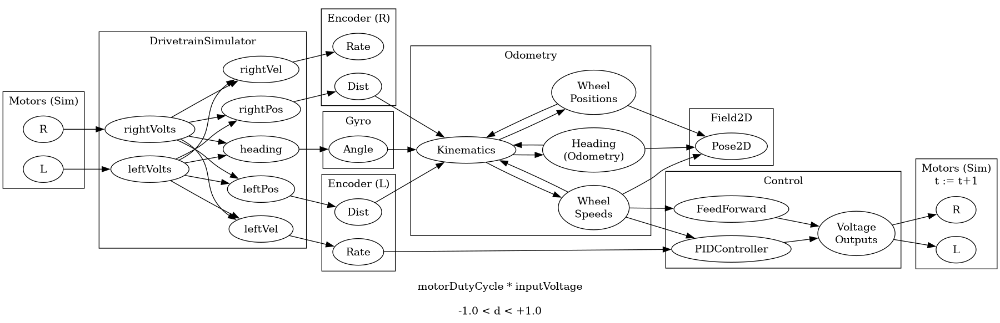

:PROPERTIES:
:ID:       891df5ee-2b34-40ec-a7da-92e16c5424b2
:END:
#+TITLE: FRC: WPILib 2027                                                                                                                                                                                               @slips                                                 
#+CATEGORY: slips
#+TAGS:

* Roam
+ [[id:c75cd36b-4d43-42e6-806e-450433a0c3f9][FRC]]
+ [[id:18d07822-9dda-4430-85a1-f7eb39f40429][VSCode]]
+ [[id:97ae00f5-9337-4108-b85f-1edfc7f86ed7][Java]]

* Resources

* Notes

** Project Templates

** Vendor Deps

After generating the "Commands v3 REBUILT" project, needed to check vendor dep
availability to gauge support at launch, esp. for hardware.

|                     | type       | c++ | java | python | notes                                    |
|---------------------+------------+-----+------+--------+------------------------------------------|
| advantage kit       | logging    | ✓   | ✓    | no     | [[https://github.com/1757WestwoodRobotics/PyKit][1757WestwoodRobotics/PyKit]]               |
| choreo              | trajectory | ✓   | ✓    | ✓      | Java only: AutoFactory, etc              |
| phoenix v6          | hw         | ✓   | ✓    | ✓      |                                          |
| phoenix v6 replay   | hw         | ✓   | ✓    | ?      |                                          |
| doglog              | logging    | n/a | ✓    | n/a    |                                          |
| pathplannerlib      | trajectory | ✓   | ✓    | exp    | python looks early                       |
| reduxlib            | hw         | ✓   | ✓    | ?      |                                          |
| revlib              | hw         | ✓   | ✓    | exp    | python still early, no official examples |
| yams (commands v2)  | mechanism  | ✓   | ✓    | no     |                                          |
| yagsl (commands v2) | mechanism  | ✓   | ✓    | no     |                                          |

Some hardware support is missing for now. Photonvision is experimental for now,
but needs a =dev= build.

** Python

Just analyzing the support here.

Could be wrong about some of this... but what's confusing is that it will change
quite quickly, but not if you're waiting on it. Progress will likely be seasonal

Almost all aspects of developer workflow assume CLI usage (i.e. Git-Bash)

*** Developer environment

+ Configure LSP and =mypy= (or navigation, completion, etc have partial support)
+ Configure ty, ruff, uv, etc. Projects use =pyproject.toml=
+ Probably build on the systemcore target to avoid issues (=ssh=?)

**** Developer UI/UX

+ Strongly influenced by the domain modeling in WPILib's C/C++ code, which is
  heavily object-oriented.
  - This means that =Meters.of(1.0)= is still =Meters.of(1.0)=.
  - Some code is still somewhat verbose (bc OOP ends up that way).
  - So even though it's python, the lower-level code will feel like building on
    the java. Java feels heavy if you don't use IDE features (like the
    "Problems" tab, references or code-refactoring)
+ Most libraries expect =mypy=. This is better, assuming LSP config goes smoothly.
  - In my experience, LSP is usually left to the developer to configure, but you
    can't easily distribute/update configuration for multiple developer
    machines.
  - If LSP isn't configured consistently, it makes the learning experience weird
    bc sometimes features work, sometimes they don't.

**** Tests

[[https://robotpy.readthedocs.io/en/stable/testing.html][Docs: Unit Testing]] does indicate that robotpy makes testing a bit easier to work
with. implies that =py -3 -m robotpy coverage test= will also run test coverage.

*** Vendordeps

**** Pathplanner

Python support looks experimental for now.

+ mostly from 2 years ago. mostly version bumps since then
+ python does not bind to pathplannerlib FFI. not sure if this is a big deal
  
**** Photonvision

Supports python

+ project relies heavily on native dependencies (rknn, tflite, tensorrt) though
  these are almost entirely on the photonvision server (i.e. not a problem)
+ =photonvisionlib= does require a lot of math. Its python code definitely falls
  through to WPILib. pathplanner does somewhat

*** Templates

For now, projects can't be generated using VSCode. Most vendordeps lack as many
examples.

+ [[https://github.com/1757WestwoodRobotics/PyKit/tree/main/template_projects][1757WestwoodRobotics/PyKit ./template_projects]]

*** Installation

Instructions are still unclear about windows installation

+ The "Latest 2027" docs are still largely the same, except for sections
  covering clear changes which are mostly complete. That's how it goes for large
  documentation sites that's not generated from code. It will be updated when
  design is complete.
+ =choreo= and =pathplannerlib-python= recommend using =uv=, but this gives few
  guarantees about how a cross-compiled target will be built, _especially when
  native compilation is required for e.g. numpy_. 

Closer review of wpilib 2027 sources would make intended installation and gradle
support more clear.
  
**** Developer vs Target Platform

+ Bad news: target doesn't match the developer platform.
+ Good news: only =3.14= is supported on systemcore. This means that developers on
  need to manage one python version (dependency conflicts slightly less likely)
  - also good news: =astral-sh/uv= sources are used by [[https://github.com/robotpy/robotpy-installer/blob/f4e4f3fd2bab8f965f80efa2fbf0a0afad694f81/README.rst?plain=1#L1][robotpy-installer]], however
    its a bit complicated.

#+begin_quote
You must install a supported version of Python on a supported operating system.
Every year we upgrade RobotPy to the latest available version of Python. In 2027
we support Python =3.11/3.12/3.13/3.14=, but only =3.14= is available for the
Systemcore.
#+end_quote

IDK everything about how =uv= downloads dependencies, but its binary builds would
_not_ work for roborio. If systemcore is a typical RPi CM ARM target, then =uv=
downloads for pip packages requiring native compilation would be transparent.

Since =choreo= and =pathplannerlib= recommend =uv=, this is probably a non-issue.

** WPILibJ

*** Testing

**** Examples

Examples and some snippets have tests (like [[https://github.com/wpilibsuite/allwpilib/blob/4817543253e343afcf2b630537e995d74d21db62/wpilibjExamples/src/test/java/org/wpilib/examples/unittest/subsystems/IntakeTest.java#L18][IntakeTest.java]]), setup here:
[[https://github.com/wpilibsuite/allwpilib/blob/4817543253e343afcf2b630537e995d74d21db62/wpilibjExamples/src/main/java/org/wpilib/examples/unittest/Robot.java#L5][wpilibjExamples/src/main/java/org/wpilib/examples/unittest/Robot.java#L5]]

+ I'm not sure how to adapt the RobotContainer to match the runtime requirements
  of the gradle test targets.
+ [[https://github.com/wpilibsuite/allwpilib/blob/4817543253e343afcf2b630537e995d74d21db62/wpilibjExamples/build.gradle#L210-L240][wpilibExamples/build.gradle]] sets up multiple test targets for CI/CD, but these
  gradle files are set up slightly differently. having multiple targets in an
  application makes it simpler to do small unit tests (I think...)

**** Mocks

Internal testing makes heavy use of [[https://github.com/wpilibsuite/allwpilib/blob/4817543253e343afcf2b630537e995d74d21db62/wpilibj/src/test/java/org/wpilib/framework/OpModeRobotTest.java#L116-L140][mocked classes]] (similar [[https://github.com/wpilibsuite/allwpilib/blob/4817543253e343afcf2b630537e995d74d21db62/wpilibc/src/test/python/framework/test_opmode_robot.py#L1445-L1459][python test]]), though
those are just thin classes. These are more like mocks

+ [[https://github.com/wpilibsuite/allwpilib/blob/4817543253e343afcf2b630537e995d74d21db62/tunables/src/main/java/org/wpilib/tunable/MockTunableBackend.java#L16][MockTunableBackend.java]]
  - Usage: [[https://github.com/wpilibsuite/allwpilib/blob/4817543253e343afcf2b630537e995d74d21db62/tunables/src/test/java/org/wpilib/tunable/TunableTest.java#L35][TunableTest.java]] and [[https://github.com/dcunited001/allwpilib/blob/4817543253e343afcf2b630537e995d74d21db62/tunables/src/test/python/test_tunable.py#L22][test_tunable.py]]
+ [[https://github.com/wpilibsuite/allwpilib/blob/4817543253e343afcf2b630537e995d74d21db62/telemetry/src/main/java/org/wpilib/telemetry/MockTelemetryBackend.java#L22][MockTelemetryBackend.java]]
  - These could be difficult to work with (at the user level), unless you watch
    for subsystem/mechanism state changes or something. Definitely need the
    design intent to mock/test ahead of time.
** SystemCore
  
*** Driver Station

+ Need to create a group and add it =input= group.
+ =chgrp= on the DS bin, then run as =sgid=. Otherwise the spacebar check fails (it
  monitors input)

** Lumyn Labs

+ [[https://www.chiefdelphi.com/t/lumyn-labs-2026-product-releases-and-updates-faster-smarter-more-intuitive/508159/24][Lumyn Labs 2026 Product Releases (chiefdelphi thread)]]
+ STEP/STL in [[https://github.com/Lumyn-Labs/Downloads][Lumyn-Labs/Downloads]]

| Controller         | Headers | 
|--------------------+---------|
| ConnectorX         |     320 |
| ConnectorX Animate |    1280 |

LEDs

|          |                |
|----------+----------------|
| To Board | JST-SM (3 pin) |
| To LED   | JST-VH (3 pin) |
| Serial   | WS2812B        |

+ Roll spaced about 16mm

*** ConnectorX

** Simulation

*** DifferentialDrive

See [[https://github.com/wpilibsuite/allwpilib/blob/7ca35e5678cf32caec6a1a866ca51d0136c4c398/wpilibj/src/main/java/edu/wpi/first/wpilibj/simulation/DifferentialDrivetrainSim.java#L455-L467][DifferentialDrivetrainSim.createKitbotSim]] which should be fairly similar to
the XRP differential drive setup...

**** Example

After writing some simulation code, these examples make a lot more sense.

+ Diagram below may not be 100% accurate though
+ It's also definitely forward kinematics (i think)
  - backwards kinematics, esp with chained joints, is like backpropagation
    (kinda). it's much more difficult esp topology, control theory, electrical

[[https://github.com/wpilibsuite/allwpilib/blob/7ca35e5678cf32caec6a1a866ca51d0136c4c398/wpilibjExamples/src/main/java/edu/wpi/first/wpilibj/examples/simpledifferentialdrivesimulation/Drivetrain.java#L137][simpledifferentialdrivesimulation/Drivetrain.java#L137]] calculation of updates to
odometry, fieldSim, etc based on robot state.

#+begin_src dot :results output file :file img/frc/diff-drive-sim-signals.png
digraph G {
    rankdir=LR

    graph[label="Motors (Sim)"]
    subgraph cluster_motors {
        leftMotors[label="L"]
        rightMotors[label="R"]
    }
     
    graph[label="DrivetrainSimulator"]
    subgraph cluster_drivetrain {
      {leftVolts,rightVolts} -> {leftVel,rightVel,leftPos,rightPos,heading}
    }
    
    leftMotors -> leftVolts
    rightMotors -> rightVolts
    
    graph[label="Encoder (L)"]
    subgraph cluster_leftencoder {
        leftDist[label="Dist"]
        leftRate[label="Rate"]
        leftPos -> leftDist
        leftVel -> leftRate
    }
    graph[label="Encoder (R)"]
    subgraph cluster_rightencoder {
        rightDist[label="Dist"]
        rightRate[label="Rate"]
        rightPos -> rightDist
        rightVel -> rightRate
    }
    graph[label="Gyro"]
    subgraph cluster_gyro {
        gyroAngle[label="Angle"]
    }
    heading -> gyroAngle 
    graph[label="Odometry"]
    subgraph cluster_odometry {
        kinematics[label="Kinematics"]
        wheelPos[label="Wheel\nPositions"]
        wheelSpeeds[label="Wheel\nSpeeds"]
        angle[label="Heading\n(Odometry)"]
        {wheelSpeeds,wheelPos,angle} -> kinematics
    }
    graph[label="Field2D"]
    subgraph cluster_field {
        Pose2D[label="Pose2D"]
    }
    {gyroAngle,leftDist,rightDist} -> kinematics -> {wheelPos,wheelSpeeds,angle} -> Pose2D
    
    graph[label="Control"]
    subgraph cluster_control {
        {leftRate,wheelSpeeds} -> PIDController
        {wheelSpeeds} -> FeedForward
        Outputs[label="Voltage\nOutputs"]
        {PIDController,FeedForward} -> Outputs
    }
    
    graph[label="Motors (Sim)\nt := t+1"]
    subgraph cluster_motors2 {
        leftMotors2[label="L"]
        rightMotors2[label="R"]
    }
    
    Outputs -> {leftMotors2,rightMotors2}
    
    // gyroSim.setAngle(-drivetrain.getHeading().getDegrees());
    graph[label="motorDutyCycle * inputVoltage\n\n-1.0 < d < +1.0"]
}
#+end_src

#+RESULTS:

** Kitbot (2026)

*** Specs

| Andymark     | Product  | Part             | Type             | Mass | Ratio/Dim   | Misc                            |
|--------------+----------+------------------+------------------+------+-------------+---------------------------------|
| [[https://andymark.com/products/am14u6-6-wheel-drop-center-robot-drive-base-2025-frc-kit-of-parts-drive-base][AM14U6]]       |          | Kitbot 2026      | Chassis          |      | 22.5 x 32.3 | Long Chassis                    |
|              | [[https://andymark.com/products/toughbox-mini-s?1%29+Motor+Hardware=CIM+%2F+NEO&quantity=1&2%29+Ratio=8.46%3A1&3%29+Weight+Relief=No&4%29+Shaft+Length=AM14U&5%29+Plate+Style=None][TB2C8XUX]] | ToughBox Mini S  | Gearbox x2       |      | 8.45:1      | Default gear ratio (~17.7 ft/s) |
| [[https://andymark.com/products/rev-neo-brushless-motor-v1-1?Pinion=No%20Pinion%20%28am-4258a%29&_su_rec=LLXehrs3fzDhU2kSPf0ojjGxFRTDKYLdfTfVo1-WTrU6IfNvjoLJdiRSvXmnlraSD1Eb_8SxUmzK_QG76AKKIkkv71tJhk7EuG2AaOJu1vlWn5E4uN3IATV6jd0bNYjbamYbYAGnGutEgOZ9Py-9gTapYE7wYipE4gidp-XRlMsXxwAb8qonojr0CPte1KxRrNuhxdJ7tg13wShQ-ZBnzrO0nIwfjP94ARt6ElV1qF8vNlqQjaddzm4unU35GqeIIQFCqM_OGy5g_n9l_19lq2d-Yp0GVxFUTDIAn_3mViNh947TzZRYHlQxKKVjPMlpkZGyko_bH8ThOBNUMpQ&_su_rec_id=6cd4d397-f570-410f-9cdf-2c1ddc2960df-1792831738][am-4258a]]     |          | REV NEO          | Motor x2         |      |             | [[https://documents.andymark.com/54c3d1c84dfcc7d91a8c190247ecc7908ab63ba20cada78c9cd79d0229bf428c/am-4258%20NEO%20Brushless%20Motor%20-%20Data%20Sheet.pdf][datasheet]]                       |
| am-0940b     |          | 6" HiGrip Wheels | Wheel x6         |      | 6in         |                                 |
| am2234a-half |          |                  | Pulley halves x8 |      | 42 tooth    |                                 |
| am-2266      |          | Gates HTD Belt   |                  |      | 160 tooth   | 15mm                                  |

Gearbox:

+ =c2 + g_out= must be =64T=
+ So =(* (/ 50.0 14) (/ 45 19.0))=

|        | Ratio        | Gear ~g~      | Lg Cluster ~c1~ | Sm Cluster ~c2~ | Lg Output ~g_out~ | Output   |
|--------+--------------+-------------+---------------+---------------+-----------------+----------|
| Teeth  | 8.45:1       | 14T         | 50T           | 19T           | 45T             | 1/2" Hex |
| Radius | ... of shaft | 0.333 (8mm) | 0.375         | 0.375         | 0.5             |          |

Misc From gearbox table.

| Stall Torque     | 58.53 ft-lbs |
| Free Speed       | 670.92 rpm   |
| Wheel Speed (6") | 17.57        |

+ =(* (/ 6.0 12) pi (/ 670.0 60))=
  - about =17.54 ft/s= or =0.44 m/s=
+ without load, max rps: =(/ 670.0 60 8.45)= or =94.36 rps=
+ =(* 670.0 8.45)= or =5661.5 rpm=

| rpm in | free rpm | linear | linear (m) | V | I | Torque |
|--------+----------+--------+------------+---+---+--------|
|   5600 |      670 |  17.54 | 0.44 m/s   |   |   |        |
|   2800 |      335 |   8.75 | 0.22 m/s   |   |   |        |

Chassis Dims (requires cuts)

| Part         | Dim   |
|--------------+-------|
| Churro       | 14"   |
| Inner Plates | 32"   |
| Outer Plates | 32"   |
| End Plates   | 22.5" |

** Codespaces
*** Issues

On the discord, these are reported to have performance issues (need a beefer VM
from GH).
*** WPILib 2026
+ Last build of 2026 containers is here in [[https://github.com/wpilibsuite/docker-images/commit/2e87bea10c6d48365419458a44d0e190e2f6b12d][wpilibsuite/docker-images (2e87bea)]]
  ... maybe

*** Devenv
*** Example

[[https://github.com/DylanB5402/Stage1A-Template-9452/blob/main/.devcontainer/post-create.sh][DylanB5402/Stage1A-Template-9452 .devcontainer/post-create.sh]]

This adds [[https://github.com/devcontainers/features/tree/main/src/desktop-lite][ghcr.io/devcontainers/features/desktop-lite]]= into =.features=.
Overkill, but interesting.

** VSCode

Managing multiple installs is a problem. Team members should select a distinct
theme when first starting the editor.

*** Extensions

| extra                                |    new | version | default                       |      old |              new | microsoft                             |     old |     new |
|--------------------------------------+--------+---------+-------------------------------+----------+------------------+---------------------------------------+---------+---------|
| huntertran.auto-markdown-toc         |  3.1.2 |  3.0.15 | redhat.java                   |   1.38.0 |           1.55.0 | ms-vscode-remote.remote-containers    | 0.469.0 | 0.469.0 |
| richardwillis.vscode-spotless-gradle |  1.2.1 |   1.2.1 | wpilibsuite.vscode-wpilib     | 2026.2.1 | 2027.0.0-alpha-7 | vscjava.vscode-gradle                 |  3.17.2 |         |
| takumii.markdowntable                | 0.13.0 |  0.13.0 | vscjava.vscode-java-depenency |   0.24.1 |           0.27.6 | vscjava.vscode-java-test              |  0.44.0 |  0.46.0 |
| mermaidchart.vscode-mermaid-chart    |        |   2.5.9 | vscjava.vscode-java-debug     |   0.58.2 |           0.59.0 | ms-vscode-remote.remote-ssh           | 0.120.0 | 0.128.0 |
|                                      |        |         | ms-vscode.cpptools            |   1.28.3 |           1.33.8 | ms-vscode-remote.remote-ssh-edit      |  0.87.0 |  0.87.0 |
|                                      |        |         |                               |          |                  | ms-vscode-remote.remote-extensionpack |  0.26.0 |  0.26.0 |
|                                      |        |         |                               |          |                  | ms-vscode-remote.remote-wsl           | 0.104.3 | 0.104.3 |
|                                      |        |         |                               |          |                  | ms-vscode.remote-server               |   1.5.3 |   1.5.3 |
|                                      |        |         |                               |          |                  | ms-vscode.remote-explorer             |   0.5.0 |   0.5.0 |
|                                      |        |         |                               |          |                  |                                       |         |         |

+ mermaidchart.vscode-mermaid-chart :: requires disabling AI features
  - =mermaidChart.aiSkills.{enabled,promptOnDetect,aiExportName}=. The
    =aiExportName= was obnoxious and notifying on completely unrelated files
  - also =mermaidChart.{createDiagramFromStage,preCommitSync}.enabled=,
    =mermaidChart.enableTelemetry= and =mermaidChart.showGenerateDiagramCodeLens=

I generally _never begin_ to consider _anything_ that requires a subscription. I
cannot afford it. Why depend on a tool just to lose it later? The more valuable
the tool, the greater the disruption. This is why I have never signed up for _any
LLM_.

I wish this wasn't terrible advice, but it is. I wish that it would've lead me
to me a stronger developer... but it turns out most software/platforms skills
get you paid require a bit of money to use (looking at you, big cloud). Finding
other tools to fill the gaps leads you to strengthen skills which just aren't
"super employable".

A bit of a sore spot... Anyways

*** Other extensions

| extra                                |       new | version |
|--------------------------------------+-----------+---------|
| astral-sh.ty                         | 2026.84.0 |         |
| richardwillis.vscode-spotless-gradle |           |         |
| takumii.markdowntable                |    0.13.0 |  1.13.0 |
| mermaidchart.vscode-mermaid-chart    |           |   2.5.9 | 

**** astral-sh.ty

hmmm. can't launch from shell either

#+begin_example
/nix/store/asdf1234-vscode-extension-astral-sh-ty-2026.84.0/share/
 ...vscode/extensions/astral-sh.ty/bundled/libs/bin/ty

bash: /nix/store/asdf1234-vscode-extension-astral-sh-ty-2026.84.0/share/
 ...vscode/extensions/astral-sh.ty/bundled/libs/bin/ty: cannot execute binary file: Exec format error
#+end_example

**** Rust Analyzer

Rust requires =rustup= and =rust-analyzer=

+ =rustup= is installed in my user's nixos profile
+ using the 2026 version of nixos =vscode-with-extensions= and =nix-ld=
  - =vscode-extensions.rust-lang.rust-analyzer= is installed here
+ then =rustup toolchain install This seems sufficient for LSP to start in my workspace 

Choreo uses rust for a few features

+ =src/codegen/java= (interesting)
+ serde, packing and re/serialization (=*.traj= json files)

=./choreolib= needs to be =working-directory= for gradle builds

#+begin_src yaml
      - name: Set version (release)
        if: github.repository_owner == 'SleipnirGroup' && startsWith(github.ref, 'refs/tags/v')
        working-directory: choreolib
        run: sed -i "s/0.0.0/${GITHUB_REF##*v}/g" publish.gradle

      - name: Build with Gradle
        working-directory: choreolib
        run: ./gradlew build ${{ matrix.build-options }}
#+end_src

Probably want the docker image... But there's also a =shell.nix=

*** VSCode =settings.json=

#+begin_src shell :results output code :wrap example diff
q='to_entries | sort_by(.keys) | from_entries'
# ff=$(ls ~/{wpilib/2026,.local/share/wpilib/2027_alpha7}/vscode/VSCode-linux-x64/data/user-data/User/settings.json)
v1=~/wpilib/2026
v2=~/.local/share/wpilib/2027_alpha7

diff <(jq "$q" $v1/vscode/VSCode-linux-x64/data/user-data/User/settings.json) \
    <(jq "$q" $v2/vscode/VSCode-linux-x64/data/user-data/User/settings.json)
#+end_src

#+begin_example diff
--- /dev/fd/63	2026-10-06 01:49:20.862882819 -0400
+++ /dev/fd/62	2026-10-06 01:49:20.863882820 -0400
@@ -1,6 +1,6 @@
 {
-  "java.jdt.ls.java.home": "/home/dc/wpilib/2026/jdk",
-  "extensions.autoUpdate": false,
+  "java.jdt.ls.java.home": "/home/dc/.local/share/wpilib/2027_alpha7/jdk",
+  "extensions.autoUpdate": "off",
   "settingsSync.ignoredSettings": [
     "extensions.autoUpdate",
     "extensions.autoCheckUpdates",
@@ -10,7 +10,10 @@
     "update.showReleaseNotes",
     "java.completion.matchCase",
     "workbench.secondarySideBar.defaultVisibility",
-    "terminal.integrated.env.linux"
+    "security.workspace.trust.startupPrompt",
+    "terminal.integrated.env.linux",
+    "update.enableWindowsBackgroundUpdates",
+    "workbench.welcomePage.experimentalOnboarding"
   ],
   "extensions.autoCheckUpdates": false,
   "extensions.ignoreRecommendations": true,
@@ -19,35 +22,26 @@
   "update.showReleaseNotes": false,
   "java.completion.matchCase": "off",
   "workbench.secondarySideBar.defaultVisibility": "hidden",
+  "security.workspace.trust.startupPrompt": "once",
   "terminal.integrated.env.linux": {
-    "JAVA_HOME": "/home/dc/wpilib/2026/jdk",
-    "PATH": "/home/dc/wpilib/2026/jdk/bin:${env:PATH}"
+    "JAVA_HOME": "/home/dc/.local/share/wpilib/2027_alpha7/jdk",
+    "PATH": "/home/dc/.local/share/wpilib/2027_alpha7/jdk/bin:${env:PATH}"
   },
   "java.configuration.runtimes": [
     {
-      "name": "JavaSE-17",
-      "path": "/home/dc/wpilib/2026/jdk",
+      "name": "JavaSE-25",
+      "path": "/home/dc/.local/share/wpilib/2027_alpha7/jdk",
       "default": true
     }
   ],
   "settingsSync.ignoredExtensions": [
     "wpilibsuite.vscode-wpilib"
   ],
-  "[markdown]": {
-    "editor.wordWrap": "off"
-  },
-  "markdown-toc.depthTo": 4,
-  "markdown-toc.updateOnSave": false,
-  "chat.disableAIFeatures": true,
-  "editor.tabSize": 2,
-  "editor.lineNumbers": "off",
-  "editor.minimap.enabled": false,
-  "editor.fontFamily": "'JetBrains Mono Nerd Font','Droid Sans Mono', 'monospace', monospace",
-  "workbench.colorTheme": "Default Dark+",
-  "redhat.telemetry.enabled": false,
-  "editor.fontLigatures": false,
-  "java.jdt.ls.vmargs": "",
-  "git.blame.editorDecoration.enabled": false,
-  "git.blame.statusBarItem.enabled": true,
-  "wpilib.skipSelectSimulateExtension": true
+  "update.enableWindowsBackgroundUpdates": false,
+  "workbench.welcomePage.experimentalOnboarding": false,
+  "terminal.integrated.initialHint": false,
+  "workbench.colorTheme": "Solarized Dark",
+  "mermaidChart.aiSkills.promptOnDetect": false,
+  "mermaidChart.aiSkills.enabled": false,
+  "mermaid.vscode.aiExportName": false
 }
#+end_example

