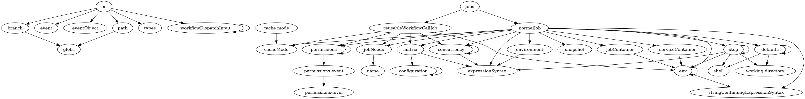
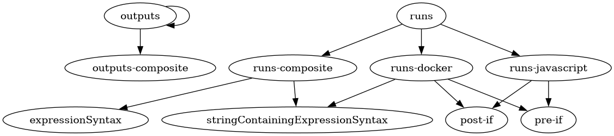
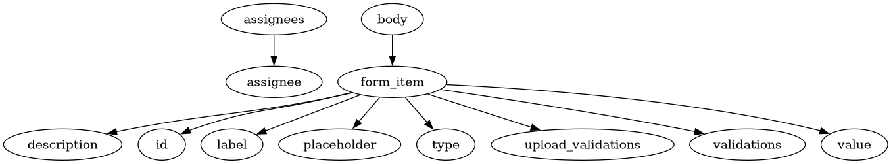
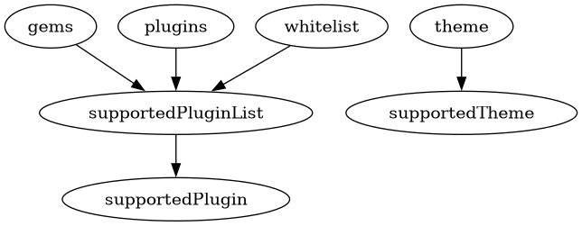

:PROPERTIES:
:ID:       b7b0aea8-43d6-4b4a-ab27-8d91617323ca
:END:
#+TITLE: Github: Schemas
#+CATEGORY: slips
#+TAGS:

* Roam
+ [[id:bb8bbe7c-6d49-4088-9161-2ae2edb4abd6][Ontology]]
+ [[id:a3dd53f7-b708-47a1-88e6-56f5c60f0576][JSON Schema Store: Extract Schemas In Bulk]]
+ [[id:96ea2679-1c00-4144-a97a-c1db570b7407][Github]]

* Github

* Schemas

** fdsa

Unsure whether these are 100% correct. It's really just an abbreviation of the
definitions of =$ref='s found at =jq= paths in the JSON Schema.

+ it depicts the composition
+ not the logic of type validation
+ and coalescesces the aggregation relationships

*** Explanation

The following short-curcuits the =pull_request= object with no clear definition
(the paths would be different if there was a definition).

#+begin_example
  "properties/on/oneOf/2/properties/pull_request/oneOf/1/allOf/0/properties/types/$ref": "#/definitions/types",
  "properties/on/oneOf/2/properties/pull_request/oneOf/1/allOf/0/properties/branches/$ref": "#/definitions/branch",
  "properties/on/oneOf/2/properties/pull_request/oneOf/1/allOf/0/properties/branches-ignore/$ref": "#/definitions/branch",
  "properties/on/oneOf/2/properties/pull_request/oneOf/1/allOf/0/properties/tags/$ref": "#/definitions/branch",
  "properties/on/oneOf/2/properties/pull_request/oneOf/1/allOf/0/properties/tags-ignore/$ref": "#/definitions/branch",
  "properties/on/oneOf/2/properties/pull_request/oneOf/1/allOf/0/properties/paths/$ref": "#/definitions/path",
  "properties/on/oneOf/2/properties/pull_request/oneOf/1/allOf/0/properties/paths-ignore/$ref": "#/definitions/path",
#+end_example

Instead of =.parent > .child= for all child nodes, it's like CSS =html >
.root-defintion .some-ref=. It focuses on the entity types that can be contained
under under nodes and coalesces the above into:

#+begin_example dot
digraph G {
  on -> { types, branch, path }
}
#+end_example

It's cheap, but I can run quick commands, somewhat reuse this code and I don't
need to maintain an environment where the code lives (nor deal with boilerplate
or =uv=, or typescript's =ajv= etc). It also requires less paper, space, filtering,
time.

*** github-workflow-schema.json

#+name: githubWorkflowSchema
#+call: jsonSchemaWalkDeps() :stdin fetchSchema(name="github-workflow")

#+begin_src dot :results output file :noweb yes :file img/devops/jsonschema-github-workflow.png
digraph G {
    <<githubWorkflowSchema()>>
}
#+end_src

#+RESULTS:

*** github-action.json

#+name: githubActionSchema
#+call: jsonSchemaWalkDeps() :stdin fetchSchema(name="github-action")

#+begin_src dot :results output file :noweb yes :file img/devops/jsonschema-github-action.png
digraph G {
    <<githubActionSchema()>>
}
#+end_src

#+RESULTS:

*** github-cli-hosts.json

additionalProperties/$ref -> "host"

#+name: githubCliHostsSchema
#+call: jsonSchemaWalkDeps() :stdin fetchSchema(name="github-cli-hosts")

#+RESULTS: githubCliHostsSchema
: "host" -> "configOptions"
: "host" -> "user"
: "user" -> "configOptions"

*** github-issue-forms.json

#+name: githubIssueFormsSchema
#+call: jsonSchemaWalkDeps() :stdin fetchSchema(name="github-issue-forms")

#+RESULTS: githubIssueFormsSchema
#+begin_example
"assignees" -> "assignee"
"body" -> "form_item"
"form_item" -> "description"
"form_item" -> "id"
"form_item" -> "label"
"form_item" -> "placeholder"
"form_item" -> "type"
"form_item" -> "upload_validations"
"form_item" -> "validations"
"form_item" -> "value"
#+end_example

#+begin_src dot :results output file :noweb yes :file img/devops/jsonschema-github-issue-forms.png
digraph G {
    <<githubIssueFormsSchema()>>
}
#+end_src

#+RESULTS:

*** github-pages-jekyll.json

#+name: githubPagesJekyllSchema
#+call: jsonSchemaWalkDeps() :stdin fetchSchema(name="github-pages-jekyll")

#+RESULTS: githubPagesJekyllSchema
: "gems" -> "supportedPluginList"
: "plugins" -> "supportedPluginList"
: "supportedPluginList" -> "supportedPlugin"
: "theme" -> "supportedTheme"
: "whitelist" -> "supportedPluginList"

#+begin_src dot :results output file :noweb yes :file img/devops/jsonschema-github-pages-jekyll.png
digraph G {
    <<githubPagesJekyllSchema()>>
}
#+end_src

#+RESULTS:

** tofix

too specific

*** github-issue-config.json

null (null) has no keys

#+name: githubIssueConfigSchema
#+call: jsonSchemaWalkDeps() :stdin fetchSchema(name="github-issue-config")

#+RESULTS: githubIssueConfigSchema
: jq: error (at <stdin>:55): null (null) has no keys

*** github-funding.json

null (null) has no keys

#+name: githubFundingSchema
#+call: jsonSchemaWalkDeps() :stdin fetchSchema(name="github-funding")

#+RESULTS: githubFundingSchema
: jq: error (at <stdin>:113): null (null) has no keys

*** github-discussion.json

null (null) has no keys

#+name: githubDiscussionSchema
#+call: jsonSchemaWalkDeps() :stdin fetchSchema(name="github-discussion")

#+RESULTS: githubDiscussionSchema
: jq: error (at <stdin>:71): null (null) has no keys

*** github-workflow-cli-config.json

null (null) has no keys

#+name: githubCliConfigSchema
#+call: jsonSchemaWalkDeps() :stdin fetchSchema(name="github-cli-config")

*** github-workflow-template-properties.json

null (null) has no keys

#+name: githubWorkflowTemplatePropertiesSchema
#+call: jsonSchemaWalkDeps() :stdin fetchSchema(name="github-workflow-template-properties")

*** github-release-config.json

null (null) has no keys

#+name: githubReleaseConfigSchema
#+call: jsonSchemaWalkDeps() :stdin fetchSchema(name="github-release-config")

*** github-secret-scanning.json

null (null) has no keys

#+name: githubSecretScanningSchema
#+call: jsonSchemaWalkDeps() :stdin fetchSchema(name="github-secret-scanning")

*** github-prompt.json

null (null) has no keys

#+name: githubPromptSchema
#+call: jsonSchemaWalkDeps() :stdin fetchSchema(name="github-prompt")

* Babel

#+name: fetchSchema
#+header: :jq . :var name="github-workflow"
#+begin_src restclient :results value code :wrap example json
:schema-url = https://json.schemastore.org/:name.json

GET :schema-url
#+end_src

#+name: jsonSchemaWalkRefs
#+begin_src jq :stdin fetchSchema
[ path(.. | select(objects and ."$ref")) as $p
  | { ($p + ["$ref"] | join("/"))
      : getpath($p)."$ref"
    }
] | add
#+end_src

#+RESULTS: jsonSchemaWalkRefs
#+begin_example
{
  "definitions/branch/$ref": "#/definitions/globs",
  "definitions/concurrency/properties/cancel-in-progress/oneOf/1/$ref": "#/definitions/expressionSyntax",
  "definitions/configuration/oneOf/3/additionalProperties/$ref": "#/definitions/configuration",
  "definitions/configuration/oneOf/4/items/$ref": "#/definitions/configuration",
  "definitions/jobContainer/properties/env/$ref": "#/definitions/env",
  "definitions/serviceContainer/properties/env/$ref": "#/definitions/env",
  "definitions/defaults/properties/run/properties/shell/$ref": "#/definitions/shell",
  "definitions/defaults/properties/run/properties/working-directory/$ref": "#/definitions/working-directory",
  "definitions/permissions/oneOf/1/$ref": "#/definitions/permissions-event",
  "definitions/permissions-event/properties/actions/$ref": "#/definitions/permissions-level",
  "definitions/permissions-event/properties/artifact-metadata/$ref": "#/definitions/permissions-level",
  "definitions/permissions-event/properties/attestations/$ref": "#/definitions/permissions-level",
  "definitions/permissions-event/properties/checks/$ref": "#/definitions/permissions-level",
  "definitions/permissions-event/properties/code-quality/$ref": "#/definitions/permissions-level",
  "definitions/permissions-event/properties/contents/$ref": "#/definitions/permissions-level",
  "definitions/permissions-event/properties/deployments/$ref": "#/definitions/permissions-level",
  "definitions/permissions-event/properties/discussions/$ref": "#/definitions/permissions-level",
  "definitions/permissions-event/properties/issues/$ref": "#/definitions/permissions-level",
  "definitions/permissions-event/properties/packages/$ref": "#/definitions/permissions-level",
  "definitions/permissions-event/properties/pages/$ref": "#/definitions/permissions-level",
  "definitions/permissions-event/properties/pull-requests/$ref": "#/definitions/permissions-level",
  "definitions/permissions-event/properties/repository-projects/$ref": "#/definitions/permissions-level",
  "definitions/permissions-event/properties/security-events/$ref": "#/definitions/permissions-level",
  "definitions/permissions-event/properties/statuses/$ref": "#/definitions/permissions-level",
  "definitions/env/oneOf/1/$ref": "#/definitions/stringContainingExpressionSyntax",
  "definitions/environment/properties/deployment/oneOf/1/$ref": "#/definitions/expressionSyntax",
  "definitions/path/$ref": "#/definitions/globs",
  "definitions/step/properties/working-directory/$ref": "#/definitions/working-directory",
  "definitions/step/properties/shell/$ref": "#/definitions/shell",
  "definitions/step/properties/with/$ref": "#/definitions/env",
  "definitions/step/properties/with/anyOf/0/$ref": "#/definitions/env",
  "definitions/step/properties/env/$ref": "#/definitions/env",
  "definitions/step/properties/continue-on-error/oneOf/1/$ref": "#/definitions/expressionSyntax",
  "definitions/step/properties/timeout-minutes/oneOf/1/$ref": "#/definitions/expressionSyntax",
  "definitions/step/properties/parallel/items/$ref": "#/definitions/step",
  "definitions/jobNeeds/oneOf/0/items/$ref": "#/definitions/name",
  "definitions/jobNeeds/oneOf/1/$ref": "#/definitions/name",
  "definitions/matrix/oneOf/0/patternProperties/^(in|ex)clude$/oneOf/0/$ref": "#/definitions/expressionSyntax",
  "definitions/matrix/oneOf/0/patternProperties/^(in|ex)clude$/oneOf/1/items/additionalProperties/$ref": "#/definitions/configuration",
  "definitions/matrix/oneOf/0/additionalProperties/oneOf/0/items/$ref": "#/definitions/configuration",
  "definitions/matrix/oneOf/0/additionalProperties/oneOf/1/$ref": "#/definitions/expressionSyntax",
  "definitions/matrix/oneOf/1/$ref": "#/definitions/expressionSyntax",
  "definitions/reusableWorkflowCallJob/properties/needs/$ref": "#/definitions/jobNeeds",
  "definitions/reusableWorkflowCallJob/properties/permissions/$ref": "#/definitions/permissions",
  "definitions/reusableWorkflowCallJob/properties/cache-mode/$ref": "#/definitions/cacheMode",
  "definitions/reusableWorkflowCallJob/properties/with/$ref": "#/definitions/env",
  "definitions/reusableWorkflowCallJob/properties/secrets/oneOf/0/$ref": "#/definitions/env",
  "definitions/reusableWorkflowCallJob/properties/strategy/properties/matrix/$ref": "#/definitions/matrix",
  "definitions/reusableWorkflowCallJob/properties/concurrency/oneOf/1/$ref": "#/definitions/concurrency",
  "definitions/normalJob/properties/needs/$ref": "#/definitions/jobNeeds",
  "definitions/normalJob/properties/snapshot/$ref": "#/definitions/snapshot",
  "definitions/normalJob/properties/permissions/$ref": "#/definitions/permissions",
  "definitions/normalJob/properties/cache-mode/$ref": "#/definitions/cacheMode",
  "definitions/normalJob/properties/runs-on/anyOf/3/$ref": "#/definitions/stringContainingExpressionSyntax",
  "definitions/normalJob/properties/runs-on/anyOf/4/$ref": "#/definitions/expressionSyntax",
  "definitions/normalJob/properties/environment/oneOf/1/$ref": "#/definitions/environment",
  "definitions/normalJob/properties/env/$ref": "#/definitions/env",
  "definitions/normalJob/properties/defaults/$ref": "#/definitions/defaults",
  "definitions/normalJob/properties/steps/items/$ref": "#/definitions/step",
  "definitions/normalJob/properties/timeout-minutes/oneOf/1/$ref": "#/definitions/expressionSyntax",
  "definitions/normalJob/properties/strategy/properties/matrix/$ref": "#/definitions/matrix",
  "definitions/normalJob/properties/continue-on-error/oneOf/1/$ref": "#/definitions/expressionSyntax",
  "definitions/normalJob/properties/container/oneOf/1/$ref": "#/definitions/jobContainer",
  "definitions/normalJob/properties/services/additionalProperties/$ref": "#/definitions/serviceContainer",
  "definitions/normalJob/properties/concurrency/oneOf/1/$ref": "#/definitions/concurrency",
  "definitions/workflowDispatchInput/oneOf/4/properties/options/$ref": "#/definitions/workflowDispatchInput/properties/options",
  "properties/on/oneOf/0/$ref": "#/definitions/event",
  "properties/on/oneOf/1/items/$ref": "#/definitions/event",
  "properties/on/oneOf/2/properties/branch_protection_rule/$ref": "#/definitions/eventObject",
  "properties/on/oneOf/2/properties/branch_protection_rule/oneOf/1/properties/types/$ref": "#/definitions/types",
  "properties/on/oneOf/2/properties/check_run/$ref": "#/definitions/eventObject",
  "properties/on/oneOf/2/properties/check_run/oneOf/1/properties/types/$ref": "#/definitions/types",
  "properties/on/oneOf/2/properties/check_suite/$ref": "#/definitions/eventObject",
  "properties/on/oneOf/2/properties/check_suite/oneOf/1/properties/types/$ref": "#/definitions/types",
  "properties/on/oneOf/2/properties/create/$ref": "#/definitions/eventObject",
  "properties/on/oneOf/2/properties/delete/$ref": "#/definitions/eventObject",
  "properties/on/oneOf/2/properties/deployment/$ref": "#/definitions/eventObject",
  "properties/on/oneOf/2/properties/deployment_status/$ref": "#/definitions/eventObject",
  "properties/on/oneOf/2/properties/discussion/$ref": "#/definitions/eventObject",
  "properties/on/oneOf/2/properties/discussion/oneOf/1/properties/types/$ref": "#/definitions/types",
  "properties/on/oneOf/2/properties/discussion_comment/$ref": "#/definitions/eventObject",
  "properties/on/oneOf/2/properties/discussion_comment/oneOf/1/properties/types/$ref": "#/definitions/types",
  "properties/on/oneOf/2/properties/fork/$ref": "#/definitions/eventObject",
  "properties/on/oneOf/2/properties/gollum/$ref": "#/definitions/eventObject",
  "properties/on/oneOf/2/properties/issue_comment/$ref": "#/definitions/eventObject",
  "properties/on/oneOf/2/properties/issue_comment/oneOf/1/properties/types/$ref": "#/definitions/types",
  "properties/on/oneOf/2/properties/issues/$ref": "#/definitions/eventObject",
  "properties/on/oneOf/2/properties/issues/oneOf/1/properties/types/$ref": "#/definitions/types",
  "properties/on/oneOf/2/properties/label/$ref": "#/definitions/eventObject",
  "properties/on/oneOf/2/properties/label/oneOf/1/properties/types/$ref": "#/definitions/types",
  "properties/on/oneOf/2/properties/merge_group/$ref": "#/definitions/eventObject",
  "properties/on/oneOf/2/properties/merge_group/oneOf/1/properties/types/$ref": "#/definitions/types",
  "properties/on/oneOf/2/properties/milestone/$ref": "#/definitions/eventObject",
  "properties/on/oneOf/2/properties/milestone/oneOf/1/properties/types/$ref": "#/definitions/types",
  "properties/on/oneOf/2/properties/page_build/$ref": "#/definitions/eventObject",
  "properties/on/oneOf/2/properties/project/$ref": "#/definitions/eventObject",
  "properties/on/oneOf/2/properties/project/oneOf/1/properties/types/$ref": "#/definitions/types",
  "properties/on/oneOf/2/properties/project_card/$ref": "#/definitions/eventObject",
  "properties/on/oneOf/2/properties/project_card/oneOf/1/properties/types/$ref": "#/definitions/types",
  "properties/on/oneOf/2/properties/project_column/$ref": "#/definitions/eventObject",
  "properties/on/oneOf/2/properties/project_column/oneOf/1/properties/types/$ref": "#/definitions/types",
  "properties/on/oneOf/2/properties/public/$ref": "#/definitions/eventObject",
  "properties/on/oneOf/2/properties/pull_request/oneOf/1/allOf/0/properties/types/$ref": "#/definitions/types",
  "properties/on/oneOf/2/properties/pull_request/oneOf/1/allOf/0/properties/branches/$ref": "#/definitions/branch",
  "properties/on/oneOf/2/properties/pull_request/oneOf/1/allOf/0/properties/branches-ignore/$ref": "#/definitions/branch",
  "properties/on/oneOf/2/properties/pull_request/oneOf/1/allOf/0/properties/tags/$ref": "#/definitions/branch",
  "properties/on/oneOf/2/properties/pull_request/oneOf/1/allOf/0/properties/tags-ignore/$ref": "#/definitions/branch",
  "properties/on/oneOf/2/properties/pull_request/oneOf/1/allOf/0/properties/paths/$ref": "#/definitions/path",
  "properties/on/oneOf/2/properties/pull_request/oneOf/1/allOf/0/properties/paths-ignore/$ref": "#/definitions/path",
  "properties/on/oneOf/2/properties/pull_request_review/$ref": "#/definitions/eventObject",
  "properties/on/oneOf/2/properties/pull_request_review/oneOf/1/properties/types/$ref": "#/definitions/types",
  "properties/on/oneOf/2/properties/pull_request_review_comment/$ref": "#/definitions/eventObject",
  "properties/on/oneOf/2/properties/pull_request_review_comment/oneOf/1/properties/types/$ref": "#/definitions/types",
  "properties/on/oneOf/2/properties/pull_request_target/oneOf/1/allOf/0/properties/types/$ref": "#/definitions/types",
  "properties/on/oneOf/2/properties/pull_request_target/oneOf/1/allOf/0/properties/branches/$ref": "#/definitions/branch",
  "properties/on/oneOf/2/properties/pull_request_target/oneOf/1/allOf/0/properties/branches-ignore/$ref": "#/definitions/branch",
  "properties/on/oneOf/2/properties/pull_request_target/oneOf/1/allOf/0/properties/tags/$ref": "#/definitions/branch",
  "properties/on/oneOf/2/properties/pull_request_target/oneOf/1/allOf/0/properties/tags-ignore/$ref": "#/definitions/branch",
  "properties/on/oneOf/2/properties/pull_request_target/oneOf/1/allOf/0/properties/paths/$ref": "#/definitions/path",
  "properties/on/oneOf/2/properties/pull_request_target/oneOf/1/allOf/0/properties/paths-ignore/$ref": "#/definitions/path",
  "properties/on/oneOf/2/properties/push/oneOf/1/allOf/0/properties/branches/$ref": "#/definitions/branch",
  "properties/on/oneOf/2/properties/push/oneOf/1/allOf/0/properties/branches-ignore/$ref": "#/definitions/branch",
  "properties/on/oneOf/2/properties/push/oneOf/1/allOf/0/properties/tags/$ref": "#/definitions/branch",
  "properties/on/oneOf/2/properties/push/oneOf/1/allOf/0/properties/tags-ignore/$ref": "#/definitions/branch",
  "properties/on/oneOf/2/properties/push/oneOf/1/allOf/0/properties/paths/$ref": "#/definitions/path",
  "properties/on/oneOf/2/properties/push/oneOf/1/allOf/0/properties/paths-ignore/$ref": "#/definitions/path",
  "properties/on/oneOf/2/properties/registry_package/$ref": "#/definitions/eventObject",
  "properties/on/oneOf/2/properties/registry_package/oneOf/1/properties/types/$ref": "#/definitions/types",
  "properties/on/oneOf/2/properties/release/$ref": "#/definitions/eventObject",
  "properties/on/oneOf/2/properties/release/oneOf/1/properties/types/$ref": "#/definitions/types",
  "properties/on/oneOf/2/properties/status/$ref": "#/definitions/eventObject",
  "properties/on/oneOf/2/properties/watch/$ref": "#/definitions/eventObject",
  "properties/on/oneOf/2/properties/workflow_dispatch/$ref": "#/definitions/eventObject",
  "properties/on/oneOf/2/properties/workflow_dispatch/oneOf/1/properties/inputs/patternProperties/^[_a-zA-Z][a-zA-Z0-9_-]*$/$ref": "#/definitions/workflowDispatchInput",
  "properties/on/oneOf/2/properties/workflow_run/$ref": "#/definitions/eventObject",
  "properties/on/oneOf/2/properties/workflow_run/oneOf/1/properties/types/$ref": "#/definitions/types",
  "properties/on/oneOf/2/properties/repository_dispatch/$ref": "#/definitions/eventObject",
  "properties/env/$ref": "#/definitions/env",
  "properties/defaults/$ref": "#/definitions/defaults",
  "properties/concurrency/oneOf/1/$ref": "#/definitions/concurrency",
  "properties/cache-mode/$ref": "#/definitions/cacheMode",
  "properties/jobs/patternProperties/^[_a-zA-Z][a-zA-Z0-9_-]*$/oneOf/0/$ref": "#/definitions/normalJob",
  "properties/jobs/patternProperties/^[_a-zA-Z][a-zA-Z0-9_-]*$/oneOf/1/$ref": "#/definitions/reusableWorkflowCallJob",
  "properties/permissions/$ref": "#/definitions/permissions"
}
#+end_example
  
#+name: jsonSchemaDeps
#+begin_src jq :stdin jsonSchemaWalkRefs :var q=".*" :cmd-line "-r"
to_entries
  | map(select((.key | match("(definitions|properties)")) or (.value | match("(definitions|properties)"))))
  | map(. += { value: (.value | gsub("^#/definitions/(?<def>[^/]+)/?.*"; "\"\(.def)\"")) })
  | map(. += { key: (.key | gsub("^definitions/(?<def>[^/]+)/.*"; "\"\(.def)\"")) })
  | map(. += { key: (.key | gsub("^(then/|else/)?properties/(?<prop>[^/]+)/.*"; "\"\(.prop)\"")) })
  | map("\(.key) -> \(.value)")
  | sort | unique | join("\n")

# getting impatient with some of the corrections
#+end_src

#+RESULTS: jsonSchemaDeps
#+begin_example
"outputs" -> "outputs"
"outputs" -> "outputs-composite"
"runs" -> "runs-composite"
"runs" -> "runs-docker"
"runs" -> "runs-javascript"
"runs-composite" -> "expressionSyntax"
"runs-composite" -> "stringContainingExpressionSyntax"
"runs-docker" -> "post-if"
"runs-docker" -> "pre-if"
"runs-docker" -> "stringContainingExpressionSyntax"
"runs-javascript" -> "post-if"
"runs-javascript" -> "pre-if"
#+end_example

Both (bc babel)

#+name: jsonSchemaWalkDeps
#+begin_src jq :stdin jsonSchemaWalkRefs :var q=".*" :cmd-line "-r"
[ path(.. | select(objects and ."$ref")) as $p
  | { ($p + ["$ref"] | join("/"))
      : getpath($p)."$ref"
    }
] | add
| to_entries
  | map(select((.key | match("(definitions|properties)")) or (.value | match("(definitions|properties)"))))
  | map(. += { value: (.value | gsub("^#/definitions/(?<def>[^/]+)/?.*"; "\"\(.def)\"")) })
  | map(. += { key: (.key | gsub("^definitions/(?<def>[^/]+)/.*"; "\"\(.def)\"")) })
  | map(. += { key: (.key | gsub("^properties/(?<prop>[^/]+)/.*"; "\"\(.prop)\"")) })
  | map(. += { key: (.key | gsub("^(then/|else/|allOf/[0-9]+/)?properties/(?<prop>[^/]+)/.*"; "\"\(.prop)\"")) })
  | map("\(.key) -> \(.value)")
  | sort | unique | join("\n")
#+end_src

