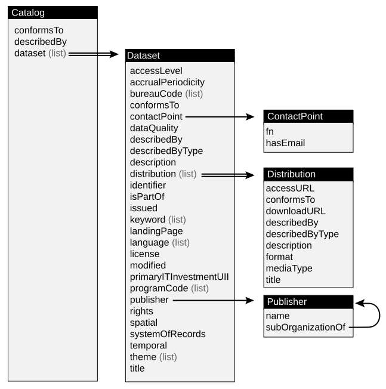

:PROPERTIES:
:ID:       dd44e493-65ce-4ccb-b770-4a5d0308aad2
:END:
#+TITLE: Datasets
#+DESCRIPTION: Open Data Sets
#+TAGS:

* Roam
+ [[id:4ab045b9-ea4b-489d-b49e-8431b70dd0a5][Data Science]]
+ [[id:fbf026c8-6c89-4ad3-a72e-2d693371c76a][Machine Learning]]

* Docs

Goddamit it's difficult to find references to this +CGAN+ CKAN software:

+ CTAN :: LaTeX packages
+ CGAL :: Computational Geometry Lib
+ CPAN :: Perl packages
+ GDAL :: Geospatial coordinate conversion

** [[https://www.ckan.org][CKAN]]

+ [[https://catalog.data.gov][catalog.data.gov]] is based on CKAN, afaik. They support open data initiatives
  for many large governments.

+ [[https://docs.ckan.org/en/2.11/contributing/architecture.html][CKAN code architecture]]

** OAI PMH

[[https://www.openarchives.org/OAI/openarchivesprotocol.htm][Open Archives Initiative]] :: [[https://www.openarchives.org/pmh/tools/][Protocol for Metadata Harvesting (PMH)]]

See below how to get data into PostgreSQL. RDF Batteries not included.... it's
hard: [[https://framagit.org/tyreunom/guile-rdf][tyreunom/guile-rdf]]

** Wikidata
+ [[https://www.wikidata.org/][Wikidata]]
+ [[https://query.wikidata.org/][SPARQL Interface: query.wikidata.org]]

+ Uses Wikibase REST API: [[https://www.wikidata.org/wiki/Wikidata:Data_access][Overview]] and [[https://doc.wikimedia.org/Wikibase/master/js/rest-api/][Swagger]]
  - [[https://github.com/derenrich/wikibase-rest-api-client][derenrich/wikibase-rest-api-client]] (python and ruby clients)
  - [[https://github.com/connorshea/wikidatum][connorshea/wikidatum]]

* Resources
** Huggingface
+ [[https://zenodo.org/records/17341083][Huggingface Model Cards Metadata Dataset]]

** Tools

*** [[https://github.com/mlcommons/croissant/tree/main/python/mlcroissant][mlcommons/mlcroissant]] 

* Topics

** Wikidata

+ Rest API can:
  - Find Wikidata item ID (QID) for a known Wikipedia page

** Media

*** MetaBrainz

+ They also have [[https://github.com/metabrainz/bookbrainz-site?tab=readme-ov-file][Bookbrainz]] and Musicbrainz, which contain PostgreSQL database
+ schemas (and probably OpenAPI docs)
+ The metabrainz github org has projects like [[https://github.com/metabrainz][metabrainz/picard]] (which tags a
  music library)

** HDF5
+ [[https://hdfeos.org/zoo/index.php][HDF5 Zoo (comprehensive examples)]] Probably the best place to start, after
  downloading [[https://www.hdfgroup.org/download-hdfview/][HDFView]]

** GIS
*** Finding Data
**** Earthdata

+ [[https://search.earthdata.nasa.gov/search?q=graph][Earth Data]] (maybe)
  - [[https://www.earthdata.nasa.gov/about/esdis/esco/standards-practices/hdf5][overview of HDF5 format]]
  - [[https://www.youtube.com/watch?v=QtfMlkd7kII][Discover and Access Earth Science Data Using Earthdata Search]]
+ [[https://openscapes.cloud/][Openscapes (jupyterhub)]] and [[https://nasa-openscapes.github.io/][NASA Openscapes]]
  - NASA Openscapes [[https://nasa-openscapes.github.io/earthdata-cloud-cookbook/our-cookbooks.html][Cookbooks]]
  - [[https://nsidc.github.io/NSIDC-Data-Cookbook/tutorials/working_with_icesat2_sea_ice_data.html][Working with ICESat-2 Sea Ice Products]] uses =earthaccess= python lib to search
    NASA Earthdata
    
***** Metadata

+ EOSDIS [[https://www.earthdata.nasa.gov/about/esdis/eosdis/cmr][CMR (Common Metadata Repository)]]
+ EMFD (EOSDIS Metadata Format Depot)
  - [[https://ecsinfo.gsfc.nasa.gov/projects/EMFD/repos/unified-metadata-model/browse][Unified Metadata Model]] it's a repo. everything's json schema. clone and
    =locate= json, filter for the highest semver.
  - DIF9 and DIF10 are at [[https://git.earthdata.nasa.gov/scm/emfd/dif-schemas.git][emfd/dif-schemas.git]] on git.earthdata.nasa.gov. It's a
    private repo. You have to be in the club. If you have to ask, you probably
    can't afford it (student loans joke; it's free, but meaninglessly
    inefficient if your social network doesn't include exclusionary libs)
+ UMM is like a [[https://www.earthdata.nasa.gov/about/esdis/eosdis/cmr/umm][Crosswalk for CMR formats]] (very interesting writeup)
  - Crosswalk is jargon for political desk jockeys with discretionary budgets

**** GeoLibre
+ [[https://github.com/opengeos/GeoLibre][opengeos/GeoLibre]] the source describes how to download/merge 1000s of datasets
  - Plugins in the default build connect to [[WASM][five major federal data brokers]],
    including NASA Eartdata & EPA EnviroAtlas
+ [[https://github.com/opengeos/geolibre-rust][opengeos/geolibre-rust]] builds to WASM

*** Bathymetry

+ [[https://nauticalcharts.noaa.gov/data/bluetopo.html][BlueTopo]] (composed from merged contributions)
+ [[https://www.gebco.net/data-products/gridded-bathymetry-data][GEBCO]]

**** Projects
+ [[https://github.com/Field-Robotics-Lab/Bathymetry_Converter][Field-Robotics-Lab/Bathymetry_Converter]] merges multiscale datasets (including
  GEBCO)

*** DGGS: Discrete Global Grid Systems

+ [[https://arxiv.org/abs/2111.00970][hex2vec: Context-Aware Embedding H3 Hexagons with OSM Tags]]

**** H3

+ [[https://towardsdatascience.com/spatial-index-tessellation-aca39463fe9f/][Spatial index: Tesselation]] Intuition behind why H3 is mostly optimal

Computed with the "authalic radius", which means an ideal spheroid (or sphere?)
that maps to an ideal placement of the equator.

#+begin_quote
Cell areas are computed with a spherical model of the earth using the authalic
radius given by WGS84/EPSG:4326.
#+end_quote

From [[https://h3geo.org/docs/core-library/restable][Tables of Cell Statistics Across Resolutions]]

So this is why there's no "Download H3 Index" link... which is why Time/Space
Complexity is useful. I can stop looking now. It doesn't exist. ~P(room) = 0~ and
~P(oom) = 1~. Yottabytes to keep a list of 64b numbers with each ID, without a map
of indices.

| hexagons |   x2048 B |                                                 |
|----------+-----------+-------------------------------------------------|
|      110 |    225280 | 110                                             |
|      842 |   1724416 | (110)*7 + 12*6                                  |
|     5882 |  12046336 | ((110)*7 + 12*5)*7 + 12*6                       |
|    41162 |  84299776 | (((110)*7 + 12*5)*7 + 12*5)*7 + 12*6            |
|   288122 | 590073856 | ((((110)*7 + 12*5)*7 + 12*5)*7 + 12*5)*7 + 12*6 |

+ Already at =res=9=, there are over =2**32= hexagons.
+ Cells have 1 parent, 6 neighbors at each resolution and 7 direct descendents
  - With 32b integers, that's =4*14B + 4B= to give each an =id= to fully connect
    hexagons in a pair of layers. So... =60 B=

| res | x2048 B (in MB) |     total |       hex | penta |
|-----+-----------------+-----------+-----------+-------|
|   0 |        0.000233 |       122 |       110 |    12 |
|   1 |        0.001606 |       842 |       830 |    12 |
|   2 |        0.011219 |      5882 |      5870 |    12 |
|   3 |        0.078510 |     41162 |     41150 |    12 |
|   4 |        0.549549 |    288122 |    288110 |    12 |
|   5 |        3.846821 |   2016842 |   2016830 |    12 |
|   6 |       26.927723 |  14117882 |  14117870 |    12 |
|   7 |      188.494040 |  98825162 |  98825150 |    12 |
|   8 |     1319.458200 | 691776122 | 691776110 |    12 |
|-----+-----------------+-----------+-----------+-------|
|     |     1539.367900 | 807072138 |           |       |
#+TBLFM: $2=$3*2048/2**30;%2f
#+TBLFM: @>$3=vsum(@2..@>>)
** OAI

*** CKAN Integration

+ ckanext-oaipmh-server :: CKAN provides access to metadata via OAI
+ ckanext-oaipmh :: CKAN acts as an OAI client
**** Data.Gov

It runs CKAN, but extending it with plugins requires 1,000 bureaucrats (for
reasons)

+ PubMed [[https://pmc.ncbi.nlm.nih.gov/tools/oai/][PMC OAI-PMH API]] and [[https://catalog.data.gov/dataset/pubmed-central-open-access-subset-pmc-oa][PubMed Central Open Access Subset (PMC OA)]]
+ [[https://catalog.data.gov/dataset/nasa-technical-reports-server-ntrs][NASA Technical Reports Server (NTRS)]]
+ [[https://catalog.data.gov/dataset/oai-pmh-for-doe-research-and-development-reports-6b113][DoE Research and Development Reports]]

*** KOHA

Another tool with a 2025 release: [[https://koha-community.org/manual/17.05/en/html/getting-started.html][Getting Started]]

*** OAI FDW

+ [[https://github.com/jimjonesbr/oai_fdw][jimjonesbr/oai_fdw]] I have to imagine that this is the one to use. One of the
  others mentioned Windows NT and I suddenly had to question my entire
  existence. This is a bit new, but idk if it works (2 minute glance), you
  should be able to ingest from multiple sources. into a fairly

IDK how it gets batched.

#+begin_src sql
CREATE SERVER oai_server_dnb FOREIGN DATA WRAPPER oai_fdw
OPTIONS (url 'https://services.dnb.de/oai/repository');

CREATE FOREIGN TABLE dnb_zdb_oai_dc (
  id text             OPTIONS (oai_node 'identifier'),
  content text        OPTIONS (oai_node 'content'),
  setspec text[]      OPTIONS (oai_node 'setspec'),
  datestamp timestamp OPTIONS (oai_node 'datestamp'),
  meta text           OPTIONS (oai_node 'metadataprefix')
 ) SERVER oai_server_dnb OPTIONS (setspec 'zdb',
                                  metadataprefix 'oai_dc',
                                  from '2022-01-31',
                                  until '2022-02-01');

-- INSERT INTO my_local_table -- to avoid polling
SELECT * FROM dnb_zdb_oai_dc
WHERE
  meta = 'MARC21-xml' AND
  datestamp BETWEEN '2022-03-01' AND '2022-03-02' AND
  setspec <@ ARRAY['dnb:reiheC'];
#+end_src

| oai:dnb.de/dnb:reiheC/1131642694 | <record xmlns="http://www.loc.gov/MARC21/slim" type="Bibliographic" ... /> | {dnb:reiheC} | 2022-03-01 13:54:09 | MARC21-xml |

*** NASA

They also use this OAI format (so does arXiv)

**** Side Trek

From the [[https://nasa-pds.github.io/pds4-information-model/index.html][PDS4 Information Model]] page

#+begin_quote
This enables data dictionary and ontology designers to share the _changing
morphology_ of the PDS model with the rest of the PDS nodes and the general
public.
#+end_quote

When I write crazy shit no one understands on my LinkedIn banner.

#+begin_quote
Epistemology with _Morphological Operators_ and Spectral Methods; Self-Styled
Philosopher
#+end_quote

it's there bc it's prominently positioned and I consider this idea to be
incredibly important -- at least to me, though obviously other people alread
understand the same ideas. No matter how crazy that wording looks now, it has to
be at the root of how AI will optimize knowledge expansion.

I'm literally talking about the boundary of an expanding/contracting knowledge
graph and using methods that look for similarity in the spectral content of
changes to the graph's boundary's which should be observed consistently if there
is some universal structure underlying knowledge (i.e. like if plato's forms are
the atoms/elements that make up the Monad). Specifially, one should apply
open/close/dilate/erode to the boundary of the graph, reevaluating it for
consistency. The trends that play out as knowledge becomes certain should
exhibit a kind of graph spectrum in the subgraphs & boundary.

Protegé, apparently an old tool, is used by the administration-department
interface in universities to queue up potential research: to decide what's
likely answerable over a 5-10 year horizon; to decide how to allocate their
staff's specific skills & resources.

**** Using PDS Deep Archive

+ Find a base URL from one of NASA's services
  - These serve collections of assets over HTTP coupled with a manifest
  - explore the URL root to get a feel for the data
  - JIRAM [[https://en.wikipedia.org/wiki/Jovian_Infrared_Auroral_Mapper][Jovian Infrared Auroral Mapper]] project has a [[https://atmos.nmsu.edu/PDS/data/jnojir_2050/DOCUMENT/JIRAM_SIS_V7.5.pdf][Software Interface
    Specification]], which covers the organization of data as well as experiment
    design and data processing ... $\frac{W}{m^{2} µm} sterad^{-1}$
  - steradians should probably be in everyone's vocab
+ Bundles have DOIs, which is nice.
  - [[https://pds.nasa.gov/ds-view/pds/viewCollection.jsp?identifier=urn%3Anasa%3Apds%3Amaven.static.c&version=4.7][10.17189/1517741]] is for MAVEN. Other MAVEN bundles are available from
    [[https://pds-ppi.igpp.ucla.edu/bundle/urn:nasa:pds:maven.static.c][ppds-ppi.igpp.ucla.edu]] (the [[https://pds-ppi.igpp.ucla.edu/index.jsp][Planetary Plasma Interactions]] host)
  - ahh here we are... the main [[https://pds.jpl.nasa.gov/][PDS page]] (nasa doesn't have a frontend designer)

* Issues

* Data.gov

+ [[https://resources.data.gov/categories/data-tools/][Data tools]] (mostly not helpful)
+ [[https://inventory.data.gov/][inventory.data.gov]] no trespassing
+ Catalog.data.gov: "we render HTML to collect analytics. no json here. scram"

** Github

"Code" for "Umerica" ...

+ [[ for][GSA/data.gov]]: a concise list of apps
+ [[https://github.com/GSA/data.gov/blob/main/SYSTEMS.md][GSA/data.gov systems.md]]: a list of Apps, APIs and service dependencies related
  to data.gov. (They renamed the master branch to main! Phew!)

** Docs

Read the [[https://strategy.data.gov/action-plan/#action-20-develop-a-data-standards-repository][2020 Action Plan]] for some context on wtf the government intended to do
five years ago ... a "five year plan" I guess.

*** DCAT-US Metadata

+ [[https://catalog.data.gov/dcat-us/validator][Validator]]
+ [[https://resources.data.gov/resources/dcat-us/][Metadata Schema 1.1]]
  - [[https://resources.data.gov/resources/podm-field-mapping/][Field Mappings]]
  - [[https://resources.data.gov/resources/documenting-apis/][Documenting APIs]] all the =data.json= files should list a =distribution= field
    with their catalogs

More or less the UML

**** History

From the [[https://www.w3.org/TR/vocab-dcat/][W3C standards doc on DCAT v3]]:

#+begin_quote
DCAT is an RDF Vocab designed to facilitate interoperability between data
catalogs published on the web.
#+end_quote

This doc was updated by democrats on August 22, 2024 ... I needed to datecheck
it, since right here at the top, it mentions SPDX. In other words, SPDX won the
"Software Supply Chain Standards" wars.

#+begin_quote
Very many of your tax dollars were used so that no one would know wtf this is.

Oh! There's a UML in the [[https://www.w3.org/TR/vocab-dcat/][vocab-dcat]] doc...

Oh... DCAT-US more closely aligns with W3C's [[https://www.w3.org/TR/vocab-dcat-1/][DCAT v1]] (2014)
#+end_quote

*** GSDM (formerly DAISM)

[[https://fiscal.treasury.gov/data-transparency/GSDM-current.html][Gov-wide Spending Data Model]], one of two schemas under [[https://resources.data.gov/standards/catalog/][Data Standards Catalog]]

** Resources

*** GSA/ckanext-datajson

LOL "youragency.gov"

#+begin_quote
You can customize the URL that generates the data.json output:

...
ckanext.datajson.path = /data.json
ckanext.datajsonld.path = /data.jsonld
ckanext.datajsonld.id = http://www.youragency.gov/data.json
...
#+end_quote

okay but seriously, how do i automagically find all the =/data.json= files?

Mainly because i hate the browser, but also because it's faster.

** Topics
*** Fiscal Service Data Registry

+ Links to [[https://fiscal.treasury.gov/data-registry/index.html][Data]]

*** Personal Data

**** LinkedIn

You can download everything afaik -- EXCEPT your "articles" (posts AND comments
on them!)

**** Google Takeout

| bond             | drive          | feedback        | gtrans        | news             | save                 |
| alerts           | embark         | google_finance  | google_wallet | personal_safety  | search_ugc           |
| checkin          | fit            | support_content | groups        | assisted_calling | search_notifications |
| arts_and_culture | fitbit         | meet            | home_graph    | backlight        | streetview           |
| course_kit       | gemini         | google_one      | keep          | pixel_telemetry  | tasks                |
| blogger          | google_account | google_pay      | gmail         | profile          | location_history     |
| calendar         | google_ads     | photos          | maps          | my_orders        | voice                |
| chrome           | my_business    | books           | local_actions | recorder         | youtube              |
| contacts         | hangouts_chat  | podcasts        | messages      | mymaps           |                      |
| discover         | earth          | shopping        | my_activity   | reminders        |                      |

cloud/etc

| firebase_dynamic_links | developer_platform |
| google_cloud_search    | workflows          |

android

| play_console | play_games_services | play_movies | play | apps_marketplace |

hardware

| google_store | pixel_aurelius | notebooklm | chrome_os_drawing_app_canvas | chrome_os_handwriting_app_a4 |

***** meta-meta-data

#+begin_src jq :stdin productsjson :results output
map(first)
#+end_src

#+RESULTS:
: jq: parse error: Invalid numeric literal at line 1, column 2

#+name: productsall
#+begin_src jq :stdin productsjson :results output file :file img/data/takeout.productsall.json
map({id: first,
     name: .[1],
     mimes: .[-6],
     sources: (.[3]| map({name: .[5],
                          formats: .[6],
                          description: .[7]})) })

   # sources is jagged, but each element has the same number 
   # map({id: first, name: .[1], mimes: .[-6], sources: (.[3] | map(length | select(. != 10))) })
#+end_src

Consolidate view

#+name: productdata
#+begin_src jq :in-file "img/data/takeout.productsall.json" :cmd-line "-rj" :results output :var productid="youtube"
map(select(.id == $productid))[] | .sources
  | map([$productid, .name, (.formats | first[0]) , .description])
  | map(@csv) | join("\n")

# | map($productid, .name, .formats[0], .description)
# | map($productid, .name, .formats[0], .description)   
# | [$productid, .name, .formats[0]]
# | reduce .[] as $p ([]; . + [$productid, ])
#+end_src

Voice data

#+call: productdata(productid="voice") :results output code :wrap example

#+RESULTS:
#+begin_example
"voice","Call logs","HTML","All calls made, received and missed"
"voice","Billing history","HTML","Your Google Voice account billing history"
"voice","Greetings","MP3","Recorded voicemail greetings"
"voice","Voicemail","MP3","Recordings of voicemail"
"voice","Phone number","VCF","Your Google Voice phone number"
"voice","Text messages","HTML","Your text message history"
#+end_example

**** Youtube

***** Quick Stats
:PROPERTIES:
:END:

****** Watch History

I definitely, definitely asked for the JSON lol.

#+begin_src shell
grep -cE '(This activity was saved to your Google Account)' \
    'YouTube\ and\ YouTube\ Music/history/watch-history.html' \
    | wc -l # 1 result ... oof
#+end_src

#+begin_src shell
sed -E 's/(This activity was saved to your Google Account)/\n\1/g' \
    watch-history-2000.html \
    | wc -l # 4531 results
#+end_src
