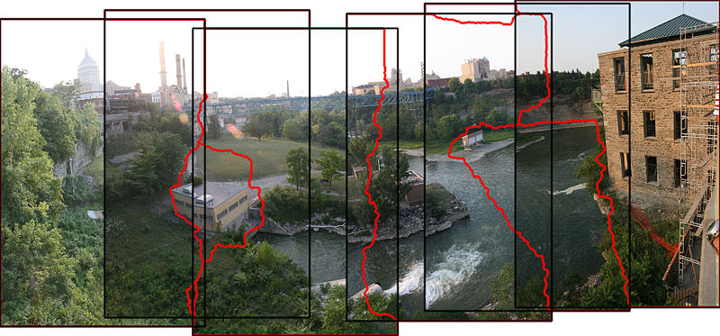
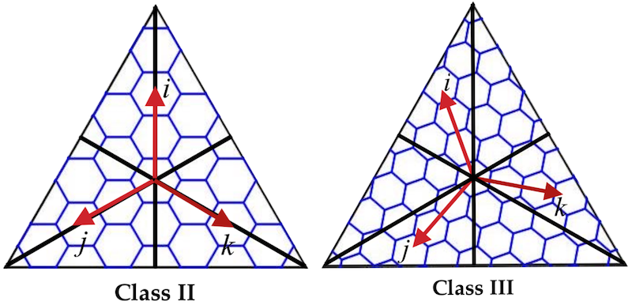

:PROPERTIES:
:ID:       a0ef7bfe-1587-4fec-ac87-f7dda5dc0d21
:END:
#+TITLE: Maths: Analysis
#+DESCRIPTION: The Shapes of Clouds and Stuff
#+TAGS:

* Docs
+ [[wikipedia:Mathematical_analysis][wikipedia:Mathematical_analysis]]

* Resources

** Complex Analysis

*** Analogue Fractals

[[https://hackaday.com/2021/07/17/finding-fractals-in-the-1930s/][This hackaday]] covers a recreation(?) of an analogue method for visualizing
fractals via video feedback.

+ [[https://www.youtube.com/watch?v=Pv26QAOcb6Q][Video demo]]
+ [[https://codeparade.itch.io/webcam-fractals][Webcam Fractals]] the interactive app. It requires fairly straight-on feed of
  your monitor into the webcam. Doesn't seem to work well with mirrors
  (translations/rotations and 3d sheer).

* Techniques

** Image Stitching

This [[https://www.youtube.com/watch?v=SSRUOIAydaI&t=600s][video about Merlin]] is a bit weird, but has a fascinating video effect that
seems to be based on image stitching across time. It is perhaps using lower
level computer vision features to cause segments of the image to appear to move
at different rates of time. The effect takes into account the Sobel filter
(contrast map) and benefits from the lighting used in the video, the latter of
which causes sharp edges (of either columns or skulls) and noise patterns (from
surface textures) to be relatively preserved in the rendered 2D image space. The
effect is first clearly understood when you see that the smoke @10:00 is moving
backwards.

The red stitching in this image connect points where there is minimal change in
the overlapping images. If you imagine a 3D stack of video frames moving through
time (in other words, 2,1 spacetime), the video effect is doing something where
you have analogous image regions that are segmented in a similar way. The
regions where there are minimal changes seem to be preserved across time.

* Modular Forms

** Docs

** Resources

+ [[https://math.vanderbilt.edu/rolenl/ModularForms.html][Lectures for Vanderbilt 9800]] (2020)
*** Stein

+ Stein [[https://www.youtube.com/watch?app=desktop&v=AxPwhJTHxSg][Counting points on the E8 Lattice with Modular Forms (theta functions)]]
+ Stein [[https://wstein.org/books/ribet-stein/][Lectures on Modular Forms and Heck Operators]] ([[https://github.com/williamstein/ribet-stein-modforms][source]])
+ [[https://wstein.org/books/modform/modform/][Modular Forms a Computational Approach (2006)]]
+ LMFDB: [[http://www.lmfdb.org/][L-functions, Modular Forms and Friends DB]]

Stein has also written a book on the Birch Swinnerton-Dyer Conjecture, but
... just run.

*** Lattices

+ Visualizations of [[http://theoryofeverything.org/theToE/2020/05/04/nested-lattices-of-e8/][E8 Root Lattice]] at ToE. These include Useful values when
  working with modular forms involving these lattice groups.

** Topics

*** Arithemetic

**** Dragons? Where?

With high-dimensional spaces, esp. involving complex numbers, then (i believe)
interpolation techniques fail for multilinear & nonlinear equations. worse,
number-theoretic problems you may encounter are *infective* with
high-dimensional data. The dot product isn't so bad with vectors... but esp with
iteration, then outer products or matrix multiplication can quickly accumulate
problems.

It would help to work with systems numerically (symbolically) where possible,
but it is not always possible. This is really way out of my league... but in the
past few days I've been thinking about:

+ difficulties I may encounter when animating modular forms using the GPU
+ ... which I would've just barely tapped into when calculating the Jacobion to
  animate the gradient.

Frederik Johannson covers

+ [[https://fredrikj.net/][Arb & Calcium merged into FLINT]] (See [[https://fredrikj.net/blog/2014/10/modular-forms-in-arb/][Modular Forms in Arb]], which uses
  [[https://arblib.org/acb_modular.html][acb_modular.h]]). He alludes to arbitrary prescision ball arithmetic here (2014)
  and published [[https://arxiv.org/abs/1611.02831][arXiv:1611.02831]]
+ And goes on to publish libraries on Hackage and apparently has taught a
  bit about it: [[https://fredrikj.net/math/berkeley2019.pdf][Progress in arbitrary-precision ball arithmetic: numerical
  integration and faster arithmetic]]

*** Lattices

+ self-dual if $disc\left(\Lambda\right) = 1 = det\left(G\right)$ where $G$ is
  the Gram Matrix.

* Topics

**** FIXME test HTML export on Github for citar citation

Does cool thing with cross product [cite:@rossling-2022-wang-algeb-from]

** Fuck if know

**** C* Algebras and Hilbert Spaces

+ Notes on [[https://users.math.msu.edu/users/banelson/conferences/GOALS/notes/vNa_notes.pdf][Von Neumann Algebras]] and mini-course

** Differential Equations

** Harmonic Analysis

*** Kakeya Conjecture

+ [[https://arxiv.org/abs/2607.14824v2][{2607.14824v2} A construction of Kakeya Sets in Arbitrary Dimension]]
  - looks like some angry aliens vomited real analysis mixed with alien alphabet
    soup, but at least left some pictures. sigma's, pi's and big cups that do
    not go together.

**** Sharp Lp Estimates

+ [[https://doi.org/10.1007/s00209-021-02944-y][Sharp Lp estimates for oscillatory integral operators of arbitrary signature]]
  - visualizes the tubes/packets. develops some background on the harmonic
    analysis. more complicated notation than openai, but less crazy.

+ llm convo describes the signature operators (on the hessian) and their
  connection to curvature (shape operator and spectral aspects)

***** URL LLM :urlllm:crypt:
:PROPERTIES:
:CRYPTKEY: David Conner <aionfork@gmail.com>
:END:

-----BEGIN PGP MESSAGE-----

hQIMAz05LBTqCkO0AQ//TrhTBxlv6x8aGKAmetqeGfdhxgVu+PFenzU27sWj9QPS
FH2eOfghpmLa0nQWKX7iq/3aHIf3d3HNROsxLGtopWAdGA8w4PKEIOpwZbwZD3/V
QIBnUMTJHdfl7ty1KJXTXKWO/+anqfxi75mdMVJsaSkm5XmnhO9mLpAZQspVTfxm
JbG98ugaZecJznTCRDllfG16OZsZONXaQktyDjq21LDHtXH87VkSt0/2owdi9sqp
COPiitpxrAEF1k761r/LciVVFza1+unbdkTyTzBOPbZnCj3AmePfKFKDvYTptYki
Y/STjYgi9HYsWfhruEsJZHTu0SPWrqIFqjwUIHdjBiWPbmPgkJFKnLrQBZS51wco
hRdgD6ofzVWmrjXWp60Bz8YCO0IteYfhRkJu/etnvuZyLqGUsUAWwP/7ayd5nSIf
uwQMuEE1eCNHEoGYexicVy5Xw8VMy1OJvhxCLOV2wFyZf0jm7Y3HnoYL4E9JhLpl
HVeYY0PA13xiilRBZVhksYgr0IfVYgx0fjAMkHgGiY4xnNI+RHXQNwqubuIQoNRE
UVZuCyruIo27nwNA7eqRoQR+tz0eDHxaBpWpMGTsiE9PExoNXlWCB2vR9fObGHR+
KpM8Tb5FqaLbfos7QX/vWC7kiG8OCzf18nnGEH9O5vUmGeDlB2AVBnvVKSI4PaTS
6QGNddL8Hh0osxOhu1+LYtF+3pMwXNPJWNhVeUjCAZi+cFt/Hx6mSERm6NhKTbo7
lnDK+DFsXaxAGhYKa2W0jhL44KFOz4wKVZET84FnkgAdDwtwUbiYARIwplLRQsOo
z5zsP+bYaZ4kyZzElblnGT9TXtyMtSwldM/3xm+XGI8Gemp6Ru9yvrFBnSE8TZWL
Nd3/rc0CXQ0wg8kvvSQAXuU+xPKHbXt43n6b/QLPiBZdp61kzNpe/gL4Rn4tJC8G
TrkIxtmw715doyn463V8sx2XZ7uV9V/DmmvVY4wGF6WSMonb97svprlgxOIGNkse
zOpA2B29kEN3kqonWG23s9EPp0JZcQfCaWnB4+vEou3Yw6OPW6SGEPhzfJd9cJJv
7ykvWlookYDQEyc8xknKbDkZLtk66rCPL8HPmKzDuwEsDGnAPEXkFsPLXJU5VJyU
C2poy6ER6vkOeVFOBAJIvjL//ny9Ui3rQMqX9kRIArAz2riF/do80MO/y7SMiiS+
eehkvs5QFdZ6qG6Bb8n/So1TicYswVvQ2AYa8fsx/8XF9p71/M+UykUjGkerD/uR
q9luWX4K/vw8/KmnEd7bonVPOia4QFPjc8AM/38Ocm/rdYSYOOhKgkmQ0mFRuCU0
r9A3uoK8RxEJX0e3c8zz9PSbUM0Pb9IClCjwM/KY698HwF8IIGMHN7FsyVZpuF5g
8nvGJ+4Q73mQWY+rX+G/f7Q2oi82U8xWDbpQStzUEbFk0fTKrBvCWURmMor+lrvk
UxZDSG/ox2aRQIDtu11GqbesrbwluARu6odgppDoEpWdRQGzR9VDCqB8f06LRnAT
I10PVCm69AavDJOXzghO+ydfeMmWNq5ovEgTNVLwGboD+XHcHBrNMy3keLRb/6XL
BdmMGPJkG55gruTofFaO8UbD33otXyeh2eM3D0iYl4+5JFbzRcgs3J32k5NptHFl
UpbU86ByIiPSKiyx/Z7gjy9mHV58JJ4ZVG4QdLg306MLF3EEICbDeXjynxSQA6Mz
4NrK3pbsfUMVlOBFhSUSK5jLX6iv9+B5xD2Ds1UgKXZOTw==
=TVKT
-----END PGP MESSAGE-----

**** komolgorov complexity

+ [[https://arxiv.org/abs/2603.25611v1][Kakeya Conjecture and Conditional Kolmogorov Complexity]]
  - clarifies the kakeya notation.

The precision =r= would benefit from an even lattice stretched over the sphere's
surface that is also close to a power of 2... no platonic solids except
tetrahedron and cube have $2^n$ vertices.

But it's difficult to subdivide a sphere into a mesh where

1) faces have equivalent area. ideally, a single value for area, maybe two (like
   archimedean solids). but really just a nice scheme for selecting a point on
   the sphere (by index), to make inferences about it's area in proportion to
   neighboring areas (triangles)
2) vertices and centers of each face are ideally equidistant (they're not)
3) the number of vertices or faces is a power of two (or factors nicely for n-D
   arrays that stride well)

So visualize =1b= $r$: two poles of sphere. increase to =4b=: 16 points on sphere.
etc, etc. That's the precision of =r=. functions related to =x= need to be computed,
so that error can be quantified/attributed to nearby sphere coordinates (angles.)

[[https://h3geo.org/][H3 mapping]] does this fairly well, but includes some problem areas

Ok... and now increase to =n-D= sphere.

*** Wavelets

**** Resources

**** Software

[[https://github.com/PyWavelets/pywt][PyWavelets/pywt]]: requires numpy/cupy

**** Topics

***** Fibonacci Wavelets

+ [[https://doi.org/10.1016/j.rico.2023.100221][The Fibonacci wavelets approach for the fractional Rosenau–Hyman equations]]
+ [[https://cmcma.sbu.ac.ir/article_103191.html][A computational method to solve fractional-order Fokker-Planck equations based
  on Touchard polynomials]]
+ [[https://www.sciencedirect.com/science/article/pii/S2211379723005466][An efficient method for the fractional electric circuits based on Fibonacci wavelet]]

[[https://www.youtube.com/watch?v=WRmBChQjZPs][One day]], I hope we'll stop seeing /paywalls/ on academic papers...

+ [[https://link.springer.com/article/10.1007/s40314-022-01853-y][Touchard wavelet technique for solving time-fractional Black–Scholes model]]
+ [[https://link.springer.com/article/10.1007/s40819-022-01329-x][Application of Two-Dimensional Fibonacci Wavelets in Fractional Partial
  Differential Equations Arising in the Financial Market]]
*** Fourier Transform

**** Types

**** Parameters

**** Resources

**** Reference
** Complex Analysis

** Real Analysis

** Combinatorial Optimization

*** Wang Algebra

[[https://arxiv.org/pdf/2208.09649][Wang Algebra: From Theory to Practice]]

The wang algebra was developed to solve systems of equations representing flows
of electricity in circuits where each loop's overall impact on the others needs
to balance out.

Since it applies to the polynomials one might generate from a graph -- using a
matroid optimization method -- then you might find that it's relevant to the ole
"coin counting problem." You know, the one you solved in CS in High School
in 2002. I'm bored. Anyways, this problem is an interesting combination of
modular arithmatic and linear algebra.

+ All coin counts must be positive. \(n_i > 0\) and \(W_i > 0\), so we only need
  to consider the positive "quadrant" of an n-dimensional space where the axes
  correspond to $n_i$
+ \[V(W,N) = \sum_{i}^{m} W_i n_i\] for weights and number of coins. Notice the
  positivity, again.

What shape does $V(W,N)$ take when parameterized by the integer domain of the
space? It is always increasing in one particular direction which isn't precisely
"in the same direction", since $n_i$ can only take integer values. So this is
the prototypical greedy algorithm.

After trying to figure out how to structure products/sums to arrive at a dual
basis for \(W\prime\) that would subtract out the diagonal from the outer
product of \(n \times W \) as zero ... it just felt like something connected to
geometric algebra, which is a cop out, since I can't explain it. You already
know you'd like \(V_\$ = W \cdot n\), but that's the answer. What other
information is available in the combinations of numbers that informs your
exploration of the space? ... Though for problems involving greedy optimization,
this is pretty mundane.

The outer product doesn't really help here. I can't really bridge what I tried
to Wang Algebra ... but it is related to combinatorial optimization since it
generates trees/cotrees of a graph. Furthermore, it is somehow related to the
Grassman Algebra.

I tried learning about matroids around 2016ish ... but without help, structure,
gradual reinforcements or foundations, concepts over time tend to blur
together. if i didn't think there was some undeveloped talent or that i could
apply math to develop models for understanding personal/social/philosophical
problems, then what's the purpose behind being such a tryhard? people have
continually told me to give up throughout my entire adult life, even when they
mean the best.

At least not without repetition and structure/order to learning. it's just not
efficient for me differentiate between set-theoretic objects like what's below.
Much of this stuff is just foundational for what's actually interesting.

|                              | Application                                                         |
|------------------------------+---------------------------------------------------------------------|
| Power Set                    | The basics                                                          |
| Hom Set                      | Anything Combinatorial in Category Theory without being overwhelmed |
| Borel Set & Sigma Algebra    | Relating measure on spaces to enable statistics.                    |
| Independent Sets of Matroids | Graphs -> polynomials, Optimization, portfolio mgmt, game theory    |
| Topology                     | Functional Analysis                                                 |
| Simplicial Complices         | Generalized Covariant Derivative                                    |

Sigma Algebra is necessary for any stocastic process. Also, when deciding
between Lebesgue or Reimann integrals, a theoretical physicist needs strong
grounding in the same ideas to ensure measure is preserved. For experimental
physics or anomaly detection -- like when determining whether it's a "6-sigma
event" -- the ability to infer, extrapolate or parameterize events from data
depends on your ability to extract as many insights as possible from redundant
measures on the Borel Set.

Try grouping/counting all unique simplicial complices. The generalized covariant
derivative can be used for Calculus with Groupoids (eventually getting to
whitehead towers) or for calculus on networks where you have criticality or
phase changes. It's hard to see how these are related ... but if you figure it
out, then the Covariant Derivative, Cristoffel symbols and Ricci Tensors should
be much easier in General Relativity.

Matroids aren't the only objects that can transform to/from systems of
equations. Generally, any object can be represented in matrix form. Block
diagrams secretly shapeshift into matrices. Orthogonal polynomial systems are
also generally useful. If you learn to generally transform discrete math into
equations, then it should be simple to turn an conceptual diagram into:

+ Tensor-based multilinear systems
+ A tensor algebra with rules for solving right-brained problems like CCG's [cite:@kartsaklisramgoolamsadrzadeh-2017-linguis-matrix-theor]:
  - see [[https://arxiv.org/pdf/1703.10252.pdf][Linguistic Matrix Theory]]
+ Tensor decompositions (using permutation/communication matrices, lattices or
  sparse matrices)

Or maybe you can't, but you discover that autocomplete in Jupyter magically
shows you names of methods you have some familiarity with and, as long as
they're not slow, you can hunt and peck for the math you need to rake in
$200,000/year.

That probably doesn't work out in the long-run, but if I was a painter, I'd know
my pigments and colors. Some of those don't mix/match. If someone wrote a
library, you can write an application that's about as easy as the MLOps -- only
if scaling is important. Otherwise, you have to be skilled at what other people
believe is difficult in order to be creative.

* References

* Roam
+ [[id:a24b12f8-b3e3-4f66-9a5c-f29b715e1506][Math]]
